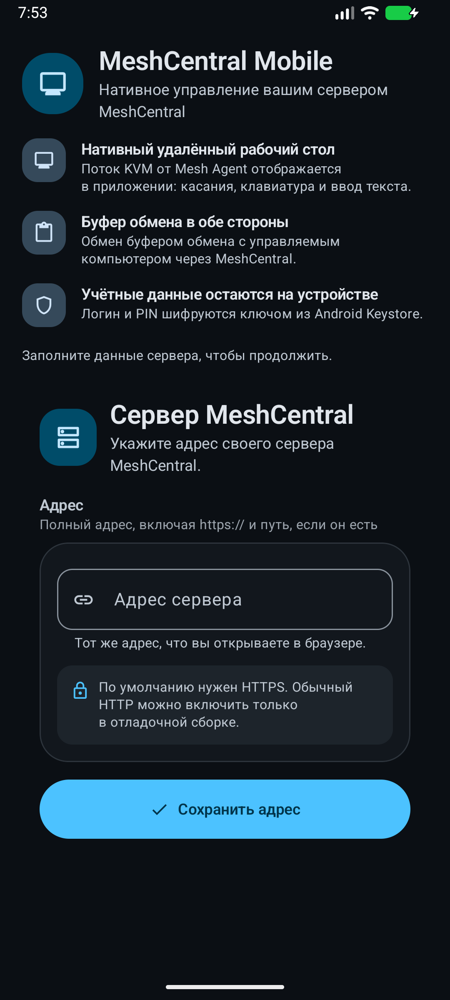
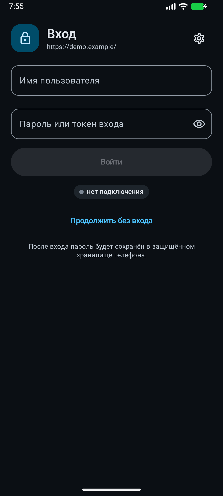

# MeshCentral Mobile

An independent native Android client for an existing [MeshCentral](https://github.com/Ylianst/MeshCentral) server. It lets you sign in to your own server, see your computers, and open a Mesh Agent remote desktop from a phone or tablet.

This is **not** an official MeshCentral application, **not** a MeshCentral agent, and **not** affiliated with the MeshCentral project. You need your own MeshCentral deployment and an account on it.

> **Status: 0.3.0 (versionCode 7), preliminary.** This release has not yet been validated on a physical device or against third-party servers. The interface is mostly Russian. See [Known limitations](docs/KNOWN_LIMITATIONS.md).

## Download and install

- APK: [GitHub Releases](https://github.com/papajon123/meshcentral-android/releases).
- Android 8.0 (API 26) or newer.
- Open the downloaded APK. Android will ask you to allow installs from the browser or file manager you used: enable **Install unknown apps** for that app, then confirm the installation.
- Updates are manual: install a newer APK from Releases. Android accepts an update only when the package name (`io.github.papajon123.meshcentral`), the signing key, and a higher `versionCode` match. A build made with your own key will not install over a release APK.
- This public application installs alongside earlier private builds. Sign in again with your own server account; no credentials are copied between applications. Debug builds have an additional `.debug` application ID suffix.

## Your own server

<p>
  
  
</p>

- Enter the full MeshCentral URL manually, for example `https://meshcentral.example.com/`. No server is preconfigured.
- Use HTTPS with a certificate valid for that host name. The release build validates certificates against the platform trust store.
- Use the final server URL. Authenticated requests do not follow HTTP redirects. Domain paths are preserved in control and viewer URLs; live deployments with reverse-proxy subpaths still need compatibility testing.
- Plain HTTP and self-signed certificates are available only in debug builds, for a local test server.
- The account needs the remote-control right for the computer group; view-only sessions are supported.

## Features

- Native Mesh Agent desktop over the MeshCentral relay, with multi-monitor switching, reconnect, and quality presets.
- Direct-touch and trackpad pointer modes, pinch zoom up to 16x, bounded panning, and a client-drawn pointer.
- On-screen keyboard, shortcut grid, Unicode text input, and view-only sessions that do not send input.
- Text clipboard exchange in both directions, subject to MeshCentral and Mesh Agent limits.
- Two-factor sign-in by e-mail, SMS, or push, as offered by the server.
- Credentials and PIN protected with Android Keystore AES-GCM; optional PIN or biometric app lock and optional screenshot blocking.
- Saved credentials and in-progress sign-in fields are isolated when the server address changes.
- No ads, analytics, telemetry, or project-operated backend. The 0.3.0 release has no in-app store, self-updater, microphone access, or APK installation flow.

## Not supported

Intel AMT KVM, Web-RDP, Web-VNC, WebRTC, terminal sessions, file management, non-agent devices, browser SSO, and clipboard images are not implemented. The raw WebView fallback in Settings is a troubleshooting aid, not the supported desktop path. See [Known limitations](docs/KNOWN_LIMITATIONS.md).

## Build

Requirements: JDK 17, Android SDK platform 35, build-tools 35.0.0. The Gradle wrapper downloads Gradle 8.10.2.

Windows PowerShell (`JAVA_HOME` and `ANDROID_HOME` must point at your installations; replace the JDK placeholder with your own JDK 17 path):

```powershell
$env:JAVA_HOME = "C:\path\to\jdk-17"
$env:ANDROID_HOME = "$env:LOCALAPPDATA\Android\Sdk"
.\gradlew.bat assembleDebug
```

Linux or macOS:

```bash
export JAVA_HOME=/path/to/jdk-17
export ANDROID_HOME="$HOME/Android/Sdk"
./gradlew assembleDebug
```

The debug APK is written to `app/build/outputs/apk/debug/app-debug.apk`.

## Tests

```bash
./gradlew testDebugUnitTest lintDebug assembleDebug
```

On Windows use `.\gradlew.bat` with the same tasks.

Instrumented tests need a dedicated emulator or test device; use reserved example domains and synthetic device data:

```bash
./gradlew connectedDebugAndroidTest
```

Final test counts and release evidence are recorded in [docs/VALIDATION.md](docs/VALIDATION.md) by the maintainer.

## Documentation

- [Architecture](docs/ARCHITECTURE.md)
- [MeshCentral protocol notes](docs/PROTOCOL.md)
- [Interface](docs/UI.md)
- [Validation](docs/VALIDATION.md)
- [Known limitations](docs/KNOWN_LIMITATIONS.md)
- [Privacy](PRIVACY.md)
- [Security policy](SECURITY.md)
- [Contributing](CONTRIBUTING.md)
- [Changelog](CHANGELOG.md)

## Reporting bugs

Open a [GitHub issue](https://github.com/papajon123/meshcentral-android/issues) with the app version, Android version, MeshCentral version, steps to reproduce, and sanitized logs. Do **not** post credentials, session cookies, real server names, or screenshots of a working desktop. Security problems go through the private channel in [SECURITY.md](SECURITY.md).

## License

Apache License 2.0. See [LICENSE](LICENSE), [NOTICE](NOTICE), and [THIRD_PARTY_NOTICES.md](THIRD_PARTY_NOTICES.md).

## Кратко по-русски

Независимый нативный Android-клиент для вашего существующего сервера MeshCentral. Это не агент Android и не официальное приложение MeshCentral; нужны собственный сервер и учётная запись на нём.

- Скачайте APK в разделе [Releases](https://github.com/papajon123/meshcentral-android/releases).
- Разрешите установку из выбранного приложения (браузера или файлового менеджера) и установите APK.
- Укажите адрес своего сервера по HTTPS с действующим сертификатом и войдите в MeshCentral.
- Обновления ставятся вручную из Releases; должны совпадать пакет и подпись, а `versionCode` — увеличиваться.
- Интерфейс пока в основном русский. Выпуск 0.3.0 предварительный: на реальных устройствах и чужих серверах он ещё не проверялся.
