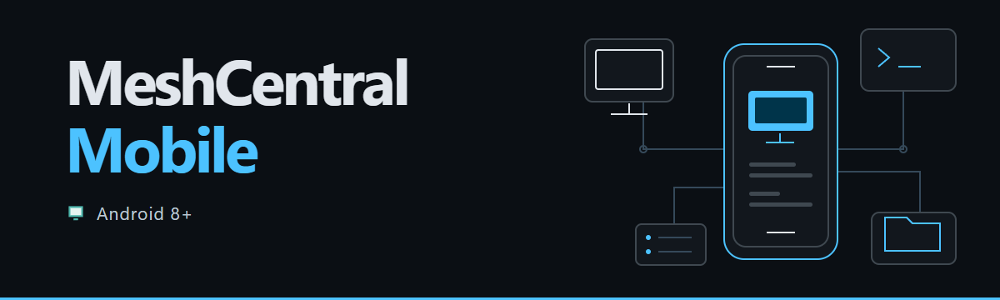
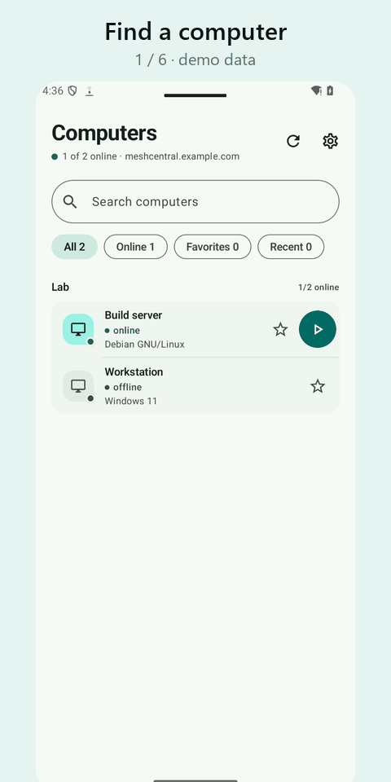

<h1 align="center"></h1>

<p align="center"><a href="README.md"><strong>English</strong></a> · <a href="README.zh-CN.md">简体中文</a> · <a href="README.ru.md">Русский</a></p>

<p align="center"><strong>An independent Android client for your own MeshCentral server: computers, desktop, terminal, files, SSH and SFTP from a phone or tablet.</strong></p>

<p align="center">
  <a href="https://github.com/papajon123/meshcentral-android/releases"><strong>Download APK</strong></a>
</p>

<p align="center">
  <a href="https://github.com/papajon123/meshcentral-android/releases"></a>
  
  
  
</p>

> **Version 0.7.3** fixes sign-in on servers that require a verification code (two-factor authentication). See the [changelog](CHANGELOG.md).

## Tour

<p align="center"></p>

<p align="center"><sub>Demo screens rendered by the app with fictional data.</sub></p>

## Why not just the web panel?

The MeshCentral web panel opens in a mobile browser, but it is designed for a desktop screen. This app is designed for touch:

- **Remote desktop for fingers:** touch and trackpad modes, keyboard, clipboard text and monitor switching; the terminal has a Ctrl, Esc, Tab and arrow key row.
- **Share to a computer:** send files from a gallery, file manager or mail app straight to a folder on a computer, verified by SHA-256.
- **All your servers in one place:** up to 20 profiles, favourites, search and recent computers; optional app lock with a PIN or biometrics.
- **Private by design:** credentials stay in Android Keystore-backed storage; no ads, analytics or project-operated backend.

## Help wanted

This is a small independent project in public preview. The most useful help right now:

- **Try it on your phone** and leave a [device report](https://github.com/papajon123/meshcentral-android/issues/new?template=device_report.yml): what works and what does not. Real phones and Windows agents are especially welcome.
- **Ask questions and share ideas** in [Discussions](https://github.com/papajon123/meshcentral-android/discussions).
- **Report bugs** with the [bug report form](https://github.com/papajon123/meshcentral-android/issues/new?template=bug_report.yml). Never post server addresses, credentials or private device data.

## Quick start

1. **Install the app.** Download the [signed APK](https://github.com/papajon123/meshcentral-android/releases). Android 8.0 (API 26) or newer is required. There is no in-app updater.
2. **Keep the same signer.** Android accepts an update only with the same package name, the same signing key and a higher `versionCode`.
3. **Connect your own server.** Enter the full HTTPS URL of your MeshCentral server, for example `https://meshcentral.example.com/`, then sign in with a MeshCentral account. No server or account is preconfigured. Browser SSO is not supported. For the terminal, install a current Android System WebView.

## What you can do

### Devices, search and profiles

- Browse groups and computers, filter by online status or favourites, and see OS, address and Agent version.
- Search the loaded list by device name, group, host/IP or OS. The query is Unicode-normalised and case-insensitive; every word must match (AND). Typing does not send a request.
- Keep up to 20 recently opened computers per profile and account. The scope key is hashed; device names and addresses are not stored in the recent list.
- Keep several server profiles (up to 20) with separate URLs, credentials, favourites and recent devices. The first profile is migrated from the existing settings. Credentials and favourites are profile-scoped; the app PIN and privacy switches stay global. Switching or deleting a profile closes its sessions.

### Sessions and the remote tools

- Keep **two sessions** open: one desktop plus one tool, or two tools. A third session is not admitted until one is closed explicitly.
- The selected device and tab survive Activity recreation; after process death the app restores the choice, not a fake live connection. Input, commands and file changes are not replayed.
- Desktop: view and control the Agent desktop with touch, trackpad, keyboard, clipboard text, monitor switching and reconnect.
- Terminal: run commands in the Agent shell. Files: browse, download to a document, upload, create folders, rename and delete. SSH and SFTP: use the server-side relays.
- Standard desktop, terminal, files, SSH and SFTP **do not require a server plugin**. Tabs follow the capabilities reported by the server; a known denial disables a tab, while missing optional data allows an explicit attempt. The server decides.

### Share to a computer

- Accept `ACTION_SEND` and `ACTION_SEND_MULTIPLE` from a file manager, gallery or mail app, up to **20** `content://` documents.
- Choose the profile, computer and folder, then upload through a visible queue. Each row has its own state, progress, cancel and explicit retry.
- Uploads are checked by readback SHA-256. A failed or cancelled transfer is never shown as success. Retry starts **from the beginning**; there is no hidden resume or offset claim.
- The source URI stays in memory only. After process death, share the file again. A foreground data-sync service keeps an active queue alive while Android permits it.

### System, services and power

- Read system, disk, memory and network data that MeshCentral already stores for the device. Missing data stays unknown; it is not shown as zero.
- With the optional plugin, list services and processes. Confirmed service start/stop/restart is available only where the Agent, OS and user rights support it; the result is checked again after the action.
- Restart, shutdown and Wake-on-LAN are offered only when the reported rights and online state allow them. A server ACK is not treated as execution: the app polls and reports reconnected, still offline or unknown.

### Jobs, history and Quick Help

- Run only fixed, allowlisted templates: `diagnostics`, `services`, `processes`, `service-start`, `service-stop` and `service-restart`. There is no arbitrary shell or user-supplied command.
- Jobs keep a status, result, exit code and bounded output. The server retains 7 days of history, at most 40 jobs and 64 KiB of output per job. `operationId` prevents a silent repeat; running jobs cannot be cancelled, and the app does not claim they were killed.
- Quick Help follows: diagnostics → explanation → confirmed action → recheck → short report. The shareable report omits the device name, IP address, user, hostname, node/job ids and raw output. Unknown findings stay unknown.

### Optional notifications

- Optional background notifications use WorkManager with a **15-minute** best-effort interval, quiet hours and per-kind filters. There is no FCM, no project push service and no permanent socket.
- After an explicit opt-in, the app stores a read-only bearer token in Android Keystore-backed storage (30-day TTL) and polls a same-origin HTTPS endpoint. Cookies, redirects, query tokens and self-signed exceptions are rejected for this path.
- Duplicate and expired events are filtered; tapping a notification routes to the right profile, device or job after unlock. A failed online revoke is reported as a limitation, not as success.

## Optional server plugin

Jobs, service/process views, confirmed service actions and background notifications use the optional **`mobilecompanion` 1.1.0** plugin. Standard desktop, terminal, files, SSH and SFTP work without it.

- Requires MeshCentral **1.3.0** and the user right `MESHRIGHT_REMOTECOMMAND (0x20000)`. Agent-console right **24 is not sufficient**.
- The plugin exposes fixed templates, ACL-checked jobs, read-only HTTP events and notification tokens. It does not patch MeshCentral core and does not accept arbitrary code or shell strings.
- The app does **not** install, configure, deploy or administer MeshCentral or the plugin. The [plugin package and its README](server/mobile-companion/README.md) are separate from the APK.
- Live acceptance used an isolated real MeshCentral 1.3.0 with a Linux Agent. Windows Agent and systemd service mutations remain untested. Multi-server MeshCentral is not supported by this plugin version.

## Validation and limitations

- Local public checks: 240 JVM tests; API 35 instrumentation: 135 passed, 4 opt-in/compatibility assumptions skipped, no failures. International, RTL, font ×2 and tablet galleries were captured. See [implementation and limits](docs/ROADMAP_IMPLEMENTATION.md).

- Windows service/process reads through Companion 1.1.2 were verified on a real Mesh Agent. Other live Windows flows, a physical phone, systemd service actions, TalkBack, physical-phone large-font acceptance, battery use, Doze/OEM restrictions and every 0.7.3 flow on Android 8 remain unverified.
- A physical-phone acceptance must still cover install/update over a signed build, sign-in/2FA, two sessions, rotation/background/lock/network loss/process death, share from real apps, notifications, and the optional plugin.
- No WebRTC in this release. WebRTC was researched, but MeshCentral 1.3.0 does not accept the terminal RTC offer; the WSS relay remains. See the [roadmap](docs/ROADMAP.md).
- Intel AMT KVM, RDP, VNC, chat, registry/software management and server administration remain in the web panel. The app does not administer the server.

## Languages

- **22 languages in 23 Android locale variants** (Simplified and Traditional Chinese are two variants of one language). Each variant has 979 translated strings plus the shared application name.
- Android 8–12 follows the system language. Android 13+ also exposes per-app language settings; there is no separate language picker inside the app.
- If no supported language matches, the app falls back to English. Arabic, Persian and Urdu use a right-to-left layout.
- Translations are machine-produced (DeepSeek) and have not been proofread by native speakers of every language. Server messages, device/file names, terminal output and physical key captions are not translated.

## Install and update

Download the signed APK from [GitHub Releases](https://github.com/papajon123/meshcentral-android/releases) and install it manually. Updates require the same package name, the same signing key and a higher `versionCode`. Earlier private builds use a different package name; they are separate applications and do not share data or signing keys.

To be notified about new versions, add `https://github.com/papajon123/meshcentral-android` to [Obtainium](https://github.com/ImranR98/Obtainium) and turn on **Include prereleases**: all current builds are public previews.

## Privacy and security

- No ads, analytics, telemetry, crash-reporting SDK or project-operated backend. The app connects to the MeshCentral server you configure.
- MeshCentral credentials and the app PIN are protected with an Android Keystore key. Android backup and device transfer are disabled; session cookies stay in process memory and can be cleared in **Settings → Data**.
- App lock is optional (PIN, Android 9+ biometrics, or both). Screenshot blocking is off by default and does not stop a camera.
- Profile credentials are scoped to their server. The notification token is read-only, Keystore-backed and revocable; Quick Help reports are redacted before sharing.
- The server operator can see connection metadata, device and session activity, and traffic through the server. Server logging, terminal recording and access control are outside the app.

Read [Privacy](PRIVACY.md) and the [Security policy](SECURITY.md).

## Documentation

- [Roadmap and release status](docs/ROADMAP.md) · [Changelog](CHANGELOG.md)
- [Architecture](docs/ARCHITECTURE.md) · [Control and desktop protocol](docs/PROTOCOL.md)
- [Interface](docs/UI.md) · [Validation](docs/VALIDATION.md) · [Known limitations](docs/KNOWN_LIMITATIONS.md)
- [Optional server plugin](server/mobile-companion/README.md)
- [Privacy](PRIVACY.md) · [Security policy](SECURITY.md) · [Contributing](CONTRIBUTING.md)

<details>
<summary>Build from source</summary>

Requirements: JDK 17, Android SDK platform 35, build-tools 35.0.0. The Gradle wrapper downloads Gradle 8.10.2.

```bash
export JAVA_HOME=/path/to/jdk-17
export ANDROID_HOME="$HOME/Android/Sdk"
./gradlew testDebugUnitTest lintDebug assembleDebug
python3 ci/check_translations.py
```

On Windows use `.\gradlew.bat` and set the same environment variables. The debug APK is written to `app/build/outputs/apk/debug/app-debug.apk`. A locally built APK is not a public release; the maintainer signs and publishes release builds.

</details>

<details>
<summary>Release identity and signature</summary>

- Application ID: `io.github.papajon123.meshcentral`
- Debug builds add a `.debug` suffix.
- Full SHA-256 of the public signing certificate:

<code>5458084705359e0d<wbr>fa9cbb83ed73a0d77<wbr>c7758370cffe2a7d<wbr>6b036e9275eeb2f</code>

The same values are kept in [ci/release-identity.json](ci/release-identity.json).

</details>

## License

Apache License 2.0. See [LICENSE](LICENSE), [NOTICE](NOTICE) and [THIRD_PARTY_NOTICES.md](THIRD_PARTY_NOTICES.md).
