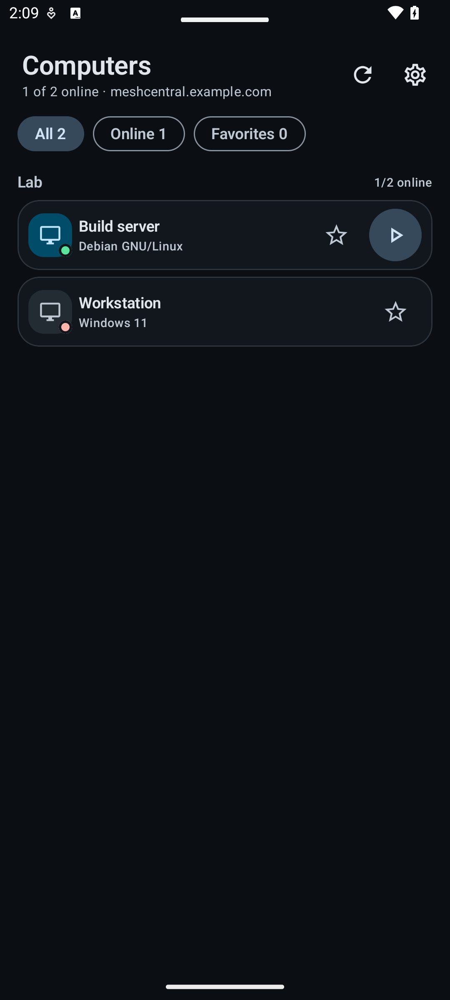
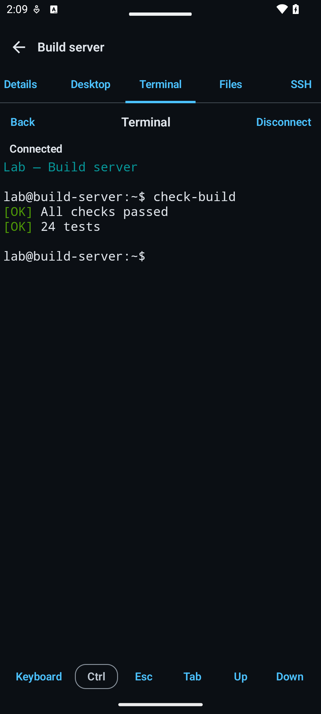
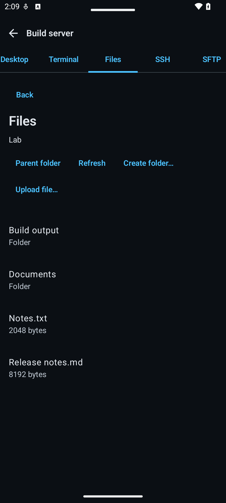

<h1 align="center"></h1>

<p align="center"><a href="README.md"><strong>English</strong></a> · <a href="README.zh-CN.md">简体中文</a> · <a href="README.ru.md">Русский</a></p>

<p align="center"><strong>An independent Android client for your own MeshCentral server: see your computers and use the desktop, terminal, files, SSH and SFTP from a phone or tablet.</strong></p>

<p align="center">
  <a href="https://github.com/papajon123/meshcentral-android/releases"><strong>Download APK</strong></a>
</p>

<p align="center">
  <a href="https://github.com/papajon123/meshcentral-android/releases"></a>
  <a href="https://github.com/papajon123/meshcentral-android/releases"></a>
  <a href="https://github.com/papajon123/meshcentral-android/stargazers"></a>
  <a href="https://github.com/papajon123/meshcentral-android/graphs/contributors"></a>
</p>
<p align="center">
  
  
  
  <a href="https://github.com/papajon123/meshcentral-android/actions/workflows/android.yml"></a>
</p>

## Screenshots

<p align="center">
  
  
  
</p>

<p align="center"><sub>Demo screens rendered by the app with fictional data. The interface is shown in English; device and file names are not automatically translated.</sub></p>

## Quick start

1. **Install the app.** Download the [signed APK](https://github.com/papajon123/meshcentral-android/releases). Android 8.0 (API 26) or newer is required.
2. **Allow the install and keep the same signer.** Android will ask you to allow installs from the browser or file manager you used. Updates need the same package name, the same signing key and a higher `versionCode`.
3. **Connect your own server.** Enter the full HTTPS URL of your MeshCentral server, for example `https://meshcentral.example.com/`, then sign in with a MeshCentral account. No server or account is preconfigured. Browser SSO is not supported. For the terminal, install a current Android System WebView. See the [first-launch setup screen](docs/screenshots/en/setup.png).

## What you can do

| Tool | What you can do | Needs |
|---|---|---|
| [Devices](docs/UI.md#device-details-and-tool-tabs) | Browse groups and computers, filter by online status or favourites, and see OS, address and Agent version. | Access to the device |
| Desktop | View and control the Agent desktop with touch, trackpad, keyboard, clipboard text, monitor switching and reconnect. | Online Agent with desktop rights |
| Terminal | Run commands in the Agent shell. | A current Android System WebView and terminal rights |
| Files | Browse, download to a document, upload, create folders, rename and delete. | Online Agent with file rights |
| SSH | Use an SSH terminal through MeshCentral. | SSH feature enabled on the server and SSH credentials |
| SFTP | Browse and transfer files over server-side SFTP. | SFTP feature enabled and device rights |

Tabs follow the capabilities reported by the server: a known denial disables a tab, while missing optional data allows an explicit attempt. The server always decides. Only one desktop, terminal or files tool is open at a time. Terminal and file sessions do not reconnect or replay input or file changes automatically.

## Preview limitations

This is a preview release, not a stable release and not a full MeshCentral client.

- **No full parity.** Intel AMT KVM, RDP, VNC and WebRTC, device events, wake/power, chat, registry/software management and server administration remain in the web panel. **Open web panel** opens the server URL in a browser with a separate sign-in.
- **Not accepted everywhere.** Checks used npm MeshCentral 1.2.5 with a real isolated Linux Mesh Agent and SSH/SFTP host. Acceptance did not cover a physical phone, a Windows Mesh Agent, Windows Agent tools, live restrictive-rights accounts or live consent/refusal flows. MeshCentral 1.2.6 was not run as a server, so compatibility with it is not claimed.
- **Server policy stays on the server.** SSH is terminated by MeshCentral; the app makes no Android host-key pinning claim. The server may record desktop, terminal, SSH/SFTP or file activity, and the absence of an in-app notice does not prove recording is off.
- **Network requirements.** The app needs HTTPS/WSS to your server and a reverse proxy that allows WebSocket upgrades. Browser SSO, `?key=` URL access keys and server administration are not supported; subpath deployments need live testing.
- **Terminal.** A working, updated Android System WebView is required. A tool session is one-shot: it does not auto-reconnect or replay earlier input. If the local renderer cannot start, the app shows an update/reopen message.
- **Files.** There is no resume or automatic retry. A failed or cancelled download can leave a partial document where you chose to save it; the app reports it and does not delete it. Cancelling an unconfirmed folder, rename or delete operation is reported as unverified.
- **Translations.** The app is translated by machine (DeepSeek) and has not been proofread by native speakers of every language.

## Languages

The interface is available in **22 languages in 23 Android locale variants**. Simplified and Traditional Chinese count as one language and two variants.

- Android 8–12 follows the system language automatically. On Android 13 and newer the app also appears in the system per-app language settings; there is no separate language picker inside the app.
- If no supported language matches, the app falls back to English. Arabic, Persian and Urdu use a right-to-left layout.
- Each variant has the same 529 translated strings. The application name is shared.
- Server messages, device and file names, terminal output and physical key captions are not translated.

English, русский, 简体中文, 繁體中文, español, français, português, Deutsch, العربية, हिन्दी, বাংলা, اردو, 日本語, 한국어, Bahasa Indonesia, Türkçe, Tiếng Việt, ไทย, italiano, فارسی, தமிழ், తెలుగు, मराठी.

## FAQ

### How do I update?
Download the new APK from [GitHub Releases](https://github.com/papajon123/meshcentral-android/releases) and install it manually. There is no in-app updater. Android accepts an update only with the same package name, the same signing key and a higher `versionCode`. The public releases use the same signing key; earlier private builds are a separate app.

### Do I need GitHub Packages?
No. The app is installed from GitHub Releases. GitHub Packages is for libraries and containers, not a replacement for the APK.

### Which certificate signs the APK?
The public package is `io.github.papajon123.meshcentral`. The full SHA-256 of the signing certificate is in the release identity section below and in [ci/release-identity.json](ci/release-identity.json). Do not install a build signed by a different key over this one.

### What about older private builds?
Earlier private builds use a different package name and remain separate applications. They do not update this public build, share its data or use its signing key. Back up what you need, then install the public app separately.

## Validation

For 0.5.1, **170 JVM tests** passed. On API 35, **66 regular Android tests** passed with seven expected skips. Six live scenarios against npm MeshCentral 1.2.5 were confirmed across two runs: a fixture-bootstrap `ProtocolException` occurred before Activity startup, and the isolated rerun passed. This was not one entirely successful live run. Evidence and untested environments are recorded in [Validation](docs/VALIDATION.md) and [Known limitations](docs/KNOWN_LIMITATIONS.md).

## Privacy and security

- No ads, analytics, telemetry, crash-reporting SDK or project-operated backend. The app connects only to the MeshCentral server you configure.
- MeshCentral credentials and the app PIN are protected with an Android Keystore key. Android backup and device transfer are disabled; session cookies stay in process memory and can be cleared in **Settings → Data**.
- App lock is optional (PIN, Android 9+ biometrics, or both). Screenshot blocking is off by default and does not stop a camera.
- The server operator can see connection metadata, device and session activity, and traffic through the server. Server logging, terminal recording and access control are outside the app.

Read [Privacy](PRIVACY.md) and the [Security policy](SECURITY.md).

## Contributors and contributing

<p align="center">
  <a href="https://github.com/papajon123"></a>
  <br>
  <a href="https://github.com/papajon123">papajon123</a>
  <br>
  <a href="https://github.com/papajon123/meshcentral-android/graphs/contributors">Contributor graph</a>
</p>

Small, focused changes with clear evidence are welcome. Read [Contributing](CONTRIBUTING.md), open an issue before a large refactor or protocol change, and never post credentials, session cookies, private keys, real server names or unsanitised logs. Report security problems through the private channel in [SECURITY.md](SECURITY.md).

## Documentation

- [Architecture](docs/ARCHITECTURE.md) · [Control and desktop protocol](docs/PROTOCOL.md)
- [Interface](docs/UI.md) · [Validation](docs/VALIDATION.md)
- [Known limitations](docs/KNOWN_LIMITATIONS.md) · [Roadmap](docs/ROADMAP.md)
- [Privacy](PRIVACY.md) · [Security policy](SECURITY.md)
- [Contributing](CONTRIBUTING.md) · [Changelog](CHANGELOG.md)

<details>
<summary>Build from source</summary>

Requirements: JDK 17, Android SDK platform 35, build-tools 35.0.0. The Gradle wrapper downloads Gradle 8.10.2.

```bash
export JAVA_HOME=/path/to/jdk-17
export ANDROID_HOME="$HOME/Android/Sdk"
./gradlew assembleDebug
```

On Windows use `.\gradlew.bat` and set the same environment variables. The debug APK is written to `app/build/outputs/apk/debug/app-debug.apk`.

Checks:

```bash
./gradlew testDebugUnitTest lintDebug assembleDebug
python3 ci/check_translations.py
```

A locally built APK is not a public release; the maintainer signs and publishes release builds.

</details>

<details>
<summary>Release identity and signature</summary>

- Application ID: `io.github.papajon123.meshcentral`
- Debug builds add a `.debug` suffix.
- Full SHA-256 of the public signing certificate:

<code>5458084705359e0d<wbr>fa9cbb83ed73a0d77<wbr>c7758370cffe2a7d<wbr>6b036e9275eeb2f</code>

The same values are kept in [ci/release-identity.json](ci/release-identity.json).

</details>

## License

Apache License 2.0. See [LICENSE](LICENSE), [NOTICE](NOTICE) and [THIRD_PARTY_NOTICES.md](THIRD_PARTY_NOTICES.md).
