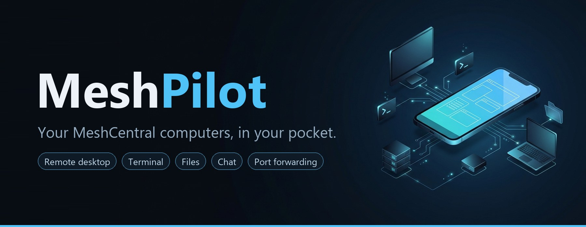
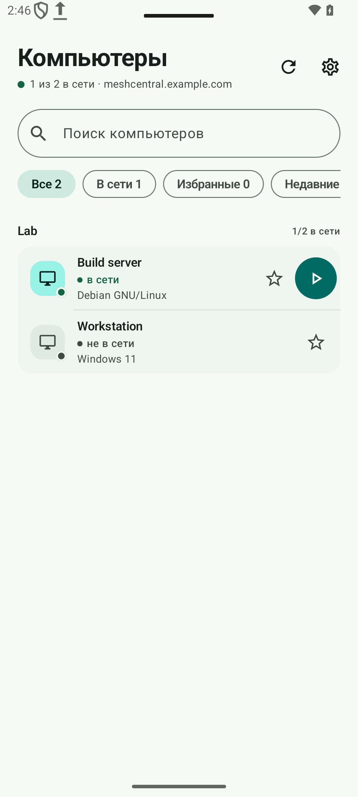
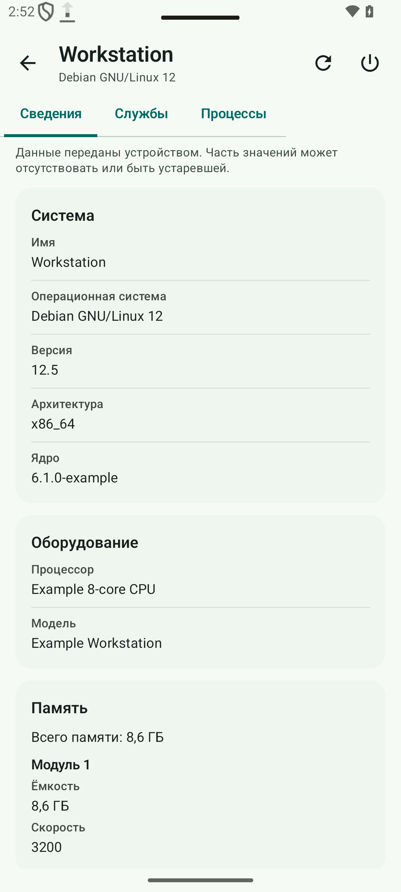
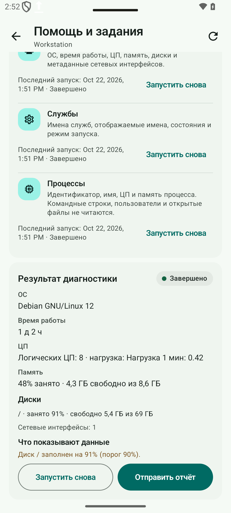

<p align="center"></p>

<p align="center"><a href="README.md">English</a> · <a href="README.zh-CN.md">简体中文</a> · <a href="README.ru.md"><strong>Русский</strong></a></p>

<p align="center"><strong>Независимый Android-клиент для вашего сервера MeshCentral: компьютеры, рабочий стол, терминал, файлы, SSH и SFTP с телефона или планшета.</strong></p>

> [!NOTE]
> **MeshPilot — независимое стороннее приложение** (раньше называлось «MeshCentral Mobile»). Оно не связано с проектом MeshCentral и его разработчиками, не одобрено и не поддерживается ими. О проблемах с приложением сообщайте в [вопросах этого репозитория](https://github.com/papajon123/meshcentral-android/issues), а не команде MeshCentral.

<p align="center">
  <a href="https://github.com/papajon123/meshcentral-android/releases/latest"></a>
  <a href="https://github.com/ImranR98/Obtainium"></a>
</p>

<p align="center">
  <a href="https://github.com/papajon123/meshcentral-android/releases"></a>
  
  
  <a href="https://boosty.to/papajon123"></a>
  
</p>

## Что нового в 0.12

- **Выбор оболочки терминала:** обычная, PowerShell или от имени вошедшего пользователя (варианты PowerShell — только в Windows).
- **Фильтры компьютеров** по группе, ОС и тегу; теги видны в списке и участвуют в поиске. **Выгрузка** показанного списка в CSV.
- **Больше места при наборе:** с открытой клавиатурой терминал занимает почти весь экран. «Назад» сохраняет сеанс рабочего стола, завершение сеанса — отдельная кнопка.
- Понятное сообщение, если компьютер не смог открыть сеанс, вместо сообщения об отказе в согласии.

Все выпуски — в [истории изменений](CHANGELOG.md).

Это клиент: вы управляете компьютерами *с телефона*. Чтобы управлять самим телефоном, установите на него официальный [агент MeshCentral для Android](https://github.com/Ylianst/MeshCentralAndroidAgent); удалённый рабочий стол в нём пока только для просмотра. Подробнее — в [сравнении вариантов](docs/COMPARISON.md) и в [политике использования ИИ](AI_POLICY.md).

## Скриншоты

<p align="center">
  
  
  
</p>

<p align="center"><sub>Демонстрационные экраны приложения с вымышленными данными. Интерфейс показан на английском; имена устройств и файлов не переводятся автоматически.</sub></p>

## Чем это лучше веб-панели в браузере телефона

Веб-панель MeshCentral открывается и в мобильном браузере, но рассчитана на большой экран. Приложение рассчитано на касания:

- **Рабочий стол под пальцы:** касания и режим тачпада, клавиатура, текст буфера обмена, переключение мониторов; в терминале — ряд клавиш Ctrl, Esc, Tab и стрелок.
- **Отправка на компьютер:** файлы из галереи, файлового менеджера или почты сразу в папку на компьютере с проверкой SHA-256.
- **Все серверы в одном месте:** до 20 профилей, избранное, поиск и недавние компьютеры; блокировка приложения PIN-кодом или биометрией.
- **Приватность:** учётные данные хранятся с защитой Android Keystore; нет рекламы, аналитики и собственного сервера проекта.

## Нужна помощь

Это небольшой независимый проект в публичной предварительной версии. Больше всего сейчас помогут:

- **Проверка на вашем телефоне** — оставьте [отчёт об устройстве](https://github.com/papajon123/meshcentral-android/issues/new?template=device_report.yml): что работает, а что нет. Особенно ценны реальные телефоны и агенты Windows.
- **Вопросы и идеи** — в [обсуждениях](https://github.com/papajon123/meshcentral-android/discussions).
- **Ошибки** — через [форму отчёта об ошибке](https://github.com/papajon123/meshcentral-android/issues/new?template=bug_report.yml). Не публикуйте адреса серверов, учётные данные и сведения о своих устройствах.

## Быстрый старт

1. **Установите приложение.** Скачайте [подписанный APK](https://github.com/papajon123/meshcentral-android/releases). Нужен Android 8.0 (API 26) или новее. С вашего согласия приложение раз в сутки проверяет обновления на GitHub; загрузка открывается в браузере.
2. **Сохраните подпись.** Android примет обновление только с тем же именем пакета, тем же ключом подписи и большим `versionCode`.
3. **Подключите свой сервер.** Введите полный HTTPS-адрес вашего MeshCentral, например `https://meshcentral.example.com/`, и войдите с учётной записью MeshCentral. Сервер и учётная запись не предустановлены. Браузерный SSO не поддерживается. Для терминала установите актуальный Android System WebView.

## Что можно делать

### Устройства, поиск и профили

- Просматривать группы и компьютеры, фильтровать по доступности или избранному, видеть ОС, адрес и версию Agent.
- Телефоны с официальным агентом MeshCentral для Android: заряд батареи, кэшированные сведения о системе и сети, просмотр экрана, файлы и запросы вибрации, фонаря, сообщения, ссылки и набора номера после подтверждения. Отправка не доказывает выполнение; для консольных действий нужны права Console. Ввод требует модифицированного агента, описанного выше.
- Искать по загруженному списку: имя устройства, группа, узел/IP или ОС. Запрос нормализуется по Unicode и не зависит от регистра; каждое слово должно совпасть (AND). Ввод не отправляет запрос на сервер.
- Хранить до 20 недавно открытых компьютеров на профиль и учётную запись. Ключ области хешируется; имена устройств и адреса в списке недавних не сохраняются.
- Держать несколько профилей серверов (до 20) с отдельными адресами, учётными данными, избранным и недавними устройствами. Первый профиль переносится из текущих настроек. Учётные данные и избранное привязаны к профилю; PIN и настройки приватности остаются общими. Переключение и удаление профиля закрывают его сеансы.

### Сеансы и удалённые инструменты

- Одновременно открыты **два сеанса**: рабочий стол плюс инструмент или два инструмента. Третий сеанс не открывается, пока один не закрыт явно.
- Выбранные устройство и вкладка переживают пересоздание Activity; после смерти процесса восстанавливается выбор, а не фиктивное живое соединение. Ввод, команды и изменения файлов автоматически не повторяются.
- Рабочий стол: просмотр и управление с помощью касаний, тачпада, клавиатуры, текстового буфера, переключения мониторов и переподключения. Есть «картинка в картинке», аппаратная мышь и клавиатура, ввод в духе DeX и режим удалённой раскладки.
- Терминал: команды в оболочке Agent, до 20 однострочных избранных команд на профиль и явное переподключение. Отдельный экран Run command предлагает предпросмотр, подтверждение и ограниченный вывод; режим **PowerShell 5+ (UTF-8)** относится к нему. В самом терминале можно выбрать оболочку: по умолчанию, PowerShell и их варианты от имени вошедшего пользователя (PowerShell — только Windows). Файлы: просмотр, скачивание в документ, загрузка, создание папок, переименование и удаление. SSH и SFTP: работа через серверные релеи.
- Стандартные рабочий стол, терминал, файлы, SSH и SFTP **не требуют серверного плагина**. Вкладки следуют возможностям, которые сообщает сервер: известный запрет отключает вкладку, отсутствие необязательных данных допускает явную попытку. Решение принимает сервер.

### «Поделиться» на компьютер

- Принимаются `ACTION_SEND` и `ACTION_SEND_MULTIPLE` из файлового менеджера, галереи или почты, до **20** документов `content://`.
- Выберите профиль, компьютер и папку; загрузка идёт через видимую очередь. У каждой строки своё состояние, прогресс, отмена и явный повтор.
- Загрузки проверяются обратным чтением SHA-256. Неудачная или отменённая передача не показывается как успешная. Повтор начинается **с начала**: скрытой докачки и обещаний смещения нет.
- URI источника хранится только в памяти. После смерти процесса файл нужно выбрать заново. Foreground-служба data-sync удерживает активную очередь, пока Android это разрешает.

### Система, службы и питание

- Система, диски, память и сеть читаются из данных, которые MeshCentral уже хранит для устройства. Отсутствующие данные остаются неизвестными, а не нулём. Онлайн-агенты также отдают инвентаризацию ПО (только чтение) и выборки CPU/RAM.
- Отображаются состояние Windows Security Center/антивируса и фильтр «Требует внимания», до 50 событий устройства, последние 100 переходов питания и семидневный график связи с неизвестными промежутками.
- С необязательным плагином доступны списки служб и процессов. Подтверждённый запуск, остановка и перезапуск службы возможны только там, где это поддерживают Agent, ОС и права пользователя; результат проверяется повторно.
- Перезагрузка, выключение, сон и Wake-on-LAN предлагаются только при подходящих правах и состоянии сети. ACK сервера не считается выполнением: приложение опрашивает устройство и сообщает «переподключилось», «осталось offline» или «неизвестно».
- Переименование устройства, описание, теги, заметки, перенос между группами, удаление и uninstall, а также ссылки-приглашения в группу с QR-кодом или отправкой (1/8/24/168 ч). Создание групп, политики и администрирование пользователей сервера выполняются только в веб-панели.
- Чат с пользователем включённого компьютера: только текст, до 200 сообщений в памяти сеанса, явное закрытие и повтор. История не пишется на диск; файлы, аудио/видео и push-сообщения нативный чат не поддерживает.
- Копирование и сохранение локализованного текстового отчёта о вкладке «Сведения». Теги редактируются в диалоге администратора, показываются в списке компьютеров и работают как фильтр. Показанный список можно выгрузить в CSV.
- Проброс TCP-портов службы на компьютере на локальный порт для внешнего RDP, VNC, SSH или браузера. Только TCP: до 64 сохранённых и 8 активных правил, 16 соединений, без UDP и VPN.
- Шифрованная паролем резервная копия настроек (PBKDF2-HMAC-SHA256 и AES-256-GCM) с профилями, избранным, сочетаниями клавиш и login key по явному выбору; пароли, cookie, токены и PIN в неё не входят. Ярлыки устройств на рабочем столе и виджет «Избранное» дополняют запуск.

### Задания, история и «Быстрая помощь»

- Разрешены только фиксированные шаблоны из allowlist: `diagnostics`, `services`, `processes`, `service-start`, `service-stop`, `service-restart`. Произвольной оболочки или пользовательских команд нет.
- У задания есть статус, результат, код завершения и ограниченный вывод. Сервер хранит историю 7 дней, не более 40 заданий и 64 KiB вывода на задание. `operationId` предотвращает скрытый повтор; выполняющееся задание нельзя отменить, и приложение не утверждает, что процесс был убит.
- «Быстрая помощь»: диагностика → объяснение → подтверждённое действие → повторная проверка → краткий отчёт. В отчёт не попадают имя устройства, IP, пользователь, hostname, id узла/задания и сырой вывод. Неизвестная причина остаётся неизвестной.

### Необязательные уведомления

- Фоновые уведомления работают через WorkManager с интервалом **15 минут** (best effort), тихими часами и фильтрами по типам. FCM, собственного push-сервиса и постоянного сокета нет.
- После явного включения приложение хранит read-only bearer-токен в Android Keystore (TTL 30 дней) и опрашивает HTTPS-endpoint того же origin. Cookie, redirect, query-токен и исключение для самоподписанного сертификата на этом пути отклоняются.
- Повторные и устаревшие события фильтруются; нажатие на уведомление после разблокировки открывает нужный профиль, устройство или задание. Неудачный online-отзыв токена показывается как ограничение, а не как успех.

## Необязательный серверный плагин

Задания, службы и процессы, подтверждённые действия со службами и фоновые уведомления используют необязательный плагин **`mobilecompanion` 1.1.2**. Стандартные рабочий стол, терминал, файлы, SSH и SFTP работают без него.

- Нужны MeshCentral **1.3.0** и право пользователя `MESHRIGHT_REMOTECOMMAND (0x20000)`. Права **24** (agent console) недостаточно.
- Плагин предоставляет фиксированные шаблоны, задания с проверкой ACL, read-only HTTP-события и токены уведомлений. Он не патчит ядро MeshCentral и не принимает произвольный код или строки shell.
- Приложение **не устанавливает**, не настраивает, не разворачивает и не администрирует MeshCentral или плагин. [Пакет плагина и его README](server/mobile-companion/README.md) отделены от APK.
- Живая приёмка шла на изолированном реальном MeshCentral 1.3.0 с Linux Agent. Действия со службами Windows Agent и systemd ещё не проверены. Multi-server MeshCentral этой версией плагина не поддерживается.

## Проверки и ограничения

- Точный охват проверок кандидата записан в [проверке 0.8.0](docs/RELEASE_0_8_0_VALIDATION.md); проверки, хеши и оставшаяся приёмка опубликованных 0.8.1 и 0.8.2 — в [проверке выпусков](docs/RELEASE_0_8_2_VALIDATION.md). Исторические результаты API 26/35, языков, RTL, крупного шрифта и планшета остаются в [реализации и ограничениях](docs/ROADMAP_IMPLEMENTATION.md); это не свежая приёмка каждого сценария 0.8.0.

- Живые доказательства охватывают Linux CPU/RAM, историю и просмотренный вывод команд ([проверки паритета](docs/PARITY_FIXES_VALIDATION.md)), а также скачивание и проверенную загрузку файлов телефона с официальным агентом 1.0.23 ([проверки файлов телефона](docs/PHONE_FILES_FIXES_VALIDATION.md)). Ввод телефона требует модифицированного агента; аппаратные эффекты, широкая приёмка Windows/macOS, физический телефон, действия служб systemd, TalkBack, расход батареи, ограничения Doze/OEM и все сценарии 0.8.0 на Android 8 остаются непроверенными.
- Приёмка на телефоне должна покрыть установку/обновление поверх подписанной сборки, вход и 2FA, два сеанса, поворот/фон/блокировку/потерю сети/смерть процесса, отправку из реальных приложений, уведомления и необязательный плагин.
- WebRTC в этом выпуске нет. Технология исследована, но MeshCentral 1.3.0 не принимает terminal RTC offer; остаётся WSS-релей. См. [план развития](docs/ROADMAP.md).
- Intel AMT KVM, RDP, VNC, управление программами и реестром, администрирование сервера по-прежнему доступны только в веб-панели. Приложение не администрирует сервер.

## Как создаётся приложение

Большую часть кода, тестов и документации пишут ИИ-агенты для программирования (Claude Code и OpenAI Codex) под руководством сопровождающего. Сопровождающий лично рецензирует каждое изменение: читает код и архитектуру в запросе на слияние и до выпуска сам проверяет поведение приложения. Автоматические проверки и правила для вкладов, сделанных с помощью ИИ, описаны в [политике использования ИИ](AI_POLICY.md).

## Языки

- **22 языка в 23 вариантах локали Android** (упрощённый и традиционный китайский — два варианта одного языка). Проверка переводов сверяет одинаковый набор ресурсов во всех вариантах; общее название приложения не переводится.
- Android 8–12 применяет язык, выбранный в **Настройки → Язык**. На Android 13 и новее тот же выбор отражается в системной настройке языка приложения. В списке есть язык системы и все 23 варианта; выходить из приложения для смены языка не нужно.
- Если подходящего языка нет, приложение переходит на английский. Арабский, персидский и урду используют направление справа налево.
- Переводы машинные (DeepSeek) и не вычитаны носителями всех языков. Сообщения сервера, имена устройств и файлов, вывод терминала и подписи физических клавиш не переводятся.

## Установка и обновление

Скачайте подписанный APK со страницы [GitHub Releases](https://github.com/papajon123/meshcentral-android/releases) и установите вручную. Для обновления нужны то же имя пакета, тот же ключ подписи и больший `versionCode`. Ранние приватные сборки используют другое имя пакета; это отдельные приложения, они не делят данные и ключ подписи.

Чтобы узнавать о новых версиях, добавьте `https://github.com/papajon123/meshcentral-android` в [Obtainium](https://github.com/ImranR98/Obtainium) и включите **Include prereleases**: все текущие сборки — предварительные.

## Приватность и безопасность

- Без рекламы, аналитики, телеметрии, SDK отчётов о сбоях и собственной серверной части проекта. Приложение подключается только к указанному вами серверу MeshCentral.
- Учётные данные MeshCentral и PIN приложения защищены ключом Android Keystore. Резервное копирование Android и перенос между устройствами отключены; cookie сеанса остаются в памяти процесса и очищаются в **Настройки → Данные**.
- Блокировка приложения необязательна (PIN, биометрия Android 9+ или оба способа). Блокировка скриншотов по умолчанию выключена и не защищает от камеры.
- Учётные данные профиля привязаны к его серверу. Токен уведомлений read-only, хранится в Keystore и отзывается; отчёты «Быстрой помощи» очищаются перед отправкой.
- Оператор сервера видит метаданные подключения, активность устройств и сеансов и трафик через сервер. Серверные журналы, запись терминала и управление доступом — вне приложения.

См. [Приватность](PRIVACY.md) и [Политику безопасности](SECURITY.md).

## Документация

- [План развития и статус выпуска](docs/ROADMAP.md) · [История изменений](CHANGELOG.md)
- [Архитектура](docs/ARCHITECTURE.md) · [Протокол управления и рабочего стола](docs/PROTOCOL.md)
- [Интерфейс](docs/UI.md) · [Проверка](docs/VALIDATION.md) · [Известные ограничения](docs/KNOWN_LIMITATIONS.md)
- [Необязательный серверный плагин](server/mobile-companion/README.md)
- [Приватность](PRIVACY.md) · [Политика безопасности](SECURITY.md) · [Участие](CONTRIBUTING.md)

<details>
<summary>Сборка из исходников</summary>

Требования: JDK 17, Android SDK platform 37, build-tools 36.0.0. Gradle wrapper скачает Gradle 9.8.2.

```bash
export JAVA_HOME=/path/to/jdk-17
export ANDROID_HOME="$HOME/Android/Sdk"
./gradlew testDirectDebugUnitTest testPlayDebugUnitTest lintDirectDebug lintPlayDebug assembleDirectDebug assemblePlayDebug bundlePlayRelease
python3 ci/check_translations.py
```

В Windows используйте `.\gradlew.bat` и задайте те же переменные среды. Отладочные APK прямой и Play-сборки появятся в `app/build/outputs/apk/direct/debug/` и `app/build/outputs/apk/play/debug/`. Play-бандл — `app/build/outputs/bundle/playRelease/app-play-release.aab`. Вариант Play отключает внешние проверки обновлений и ссылку поддержки. Локально собранный APK не становится публичным выпуском; подписывает и публикует выпуски сопровождающий проекта.

</details>

<details>
<summary>Идентичность выпуска и подпись</summary>

- ID приложения: `io.github.papajon123.meshcentral`
- Отладочные сборки добавляют суффикс `.debug`.
- Полный SHA-256 публичного сертификата подписи:

<code>5458084705359e0d<wbr>fa9cbb83ed73a0d77<wbr>c7758370cffe2a7d<wbr>6b036e9275eeb2f</code>

Те же значения хранятся в [ci/release-identity.json](ci/release-identity.json).

</details>

## Поддержать проект

MeshPilot бесплатный, открытый, без рекламы, аналитики и платных функций. Если приложение экономит вам время, разработку
можно поддержать на **[Boosty](https://boosty.to/papajon123)** подпиской или разовым донатом; Boosty принимает карты
российских и зарубежных банков. Та же ссылка есть в приложении: **Настройки → Поддержать MeshPilot**. Поддержка не
открывает функций: всё остаётся в открытом приложении.

## Лицензия

Apache License 2.0. См. [LICENSE](LICENSE), [NOTICE](NOTICE) и [THIRD_PARTY_NOTICES.md](THIRD_PARTY_NOTICES.md).
