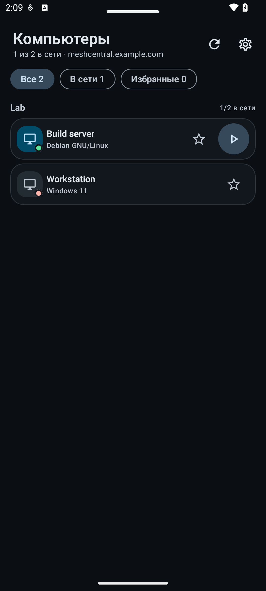
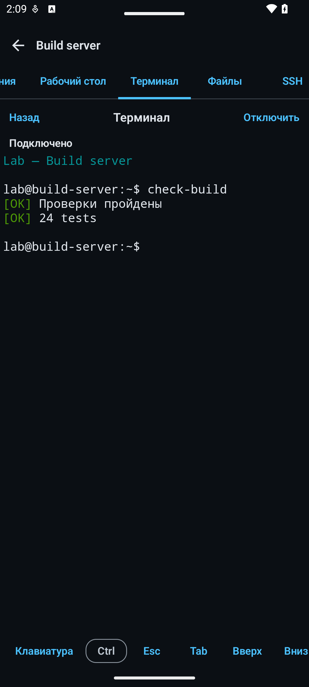
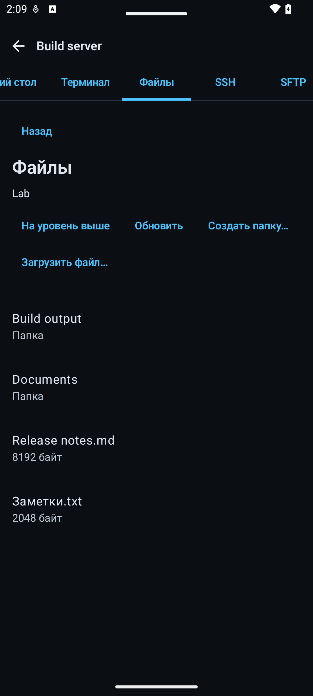

<h1 align="center"></h1>

<p align="center"><a href="README.md">English</a> · <a href="README.zh-CN.md">简体中文</a> · <a href="README.ru.md"><strong>Русский</strong></a></p>

<p align="center"><strong>Независимый Android-клиент для вашего сервера MeshCentral: компьютеры, рабочий стол, терминал, файлы, SSH и SFTP с телефона или планшета.</strong></p>

<p align="center">
  <a href="https://github.com/papajon123/meshcentral-android/releases/download/v0.5.2/meshcentral-android-0.5.2.apk"><strong>Скачать APK 0.5.2</strong></a>
  ·
  <a href="https://github.com/papajon123/meshcentral-android/releases/tag/v0.5.2">Страница выпуска</a>
  ·
  <a href="https://distribution.example.invalid/repo/?fingerprint=REDACTED_REPOSITORY_FINGERPRINT">Личный репозиторий F-Droid</a>
</p>

<p align="center">
  <a href="https://github.com/papajon123/meshcentral-android/releases"></a>
  <a href="https://github.com/papajon123/meshcentral-android/releases"></a>
  <a href="https://github.com/papajon123/meshcentral-android/stargazers"></a>
  <a href="https://github.com/papajon123/meshcentral-android/graphs/contributors"></a>
</p>
<p align="center">
  
  
  
  <a href="https://github.com/papajon123/meshcentral-android/actions/workflows/android.yml"></a>
</p>

## Скриншоты

<p align="center">
  
  
  
</p>

<p align="center"><sub>Снимки интерфейса приложения с вымышленными данными. Интерфейс показан на русском; имена устройств и файлов не переводятся автоматически.</sub></p>

## Быстрый старт

1. **Установите приложение.** Скачайте [подписанный APK 0.5.2](https://github.com/papajon123/meshcentral-android/releases/download/v0.5.2/meshcentral-android-0.5.2.apk) или добавьте [личный репозиторий F-Droid](https://distribution.example.invalid/repo/?fingerprint=REDACTED_REPOSITORY_FINGERPRINT). Это сторонний личный репозиторий, а не официальный каталог F-Droid; если клиент спросит, разрешите предварительные (beta) версии. Нужен Android 8.0 (API 26) или новее.
2. **Разрешите установку и сохраните подпись.** Android попросит разрешить установку из браузера или файлового менеджера. Для обновления нужны то же имя пакета, тот же ключ подписи и больший `versionCode`.
3. **Подключите свой сервер.** Введите полный HTTPS-адрес вашего MeshCentral, например `https://meshcentral.example.com/`, и войдите с учётной записью MeshCentral. Сервер и учётная запись не предустановлены. Браузерный SSO не поддерживается. Для терминала установите актуальный Android System WebView. См. [экран первой настройки](docs/screenshots/ru/setup.png).

## Что можно делать

| Инструмент | Что можно делать | Что нужно |
|---|---|---|
| [Устройства](docs/UI.md#device-details-and-tool-tabs) | Просматривать группы и компьютеры, фильтровать по доступности или избранному, видеть ОС, адрес и версию Agent. | Доступ к устройству |
| Рабочий стол | Смотреть и управлять рабочим столом Agent с помощью касаний, тачпада, клавиатуры и текстового буфера, переключать мониторы и переподключаться. | Agent в сети и права на рабочий стол |
| Терминал | Выполнять команды в командной оболочке Agent. | Актуальный Android System WebView и права на терминал |
| Файлы | Просматривать, скачивать в выбранный документ, загружать, создавать папки, переименовывать и удалять. | Agent в сети и права на файлы |
| SSH | Работать в SSH-терминале через MeshCentral. | Включённая функция SSH на сервере и учётные данные SSH |
| SFTP | Просматривать и передавать файлы по SFTP на стороне сервера. | Включённая функция SFTP и права на устройство |

Доступность вкладок определяется сведениями от сервера: известный запрет отключает вкладку, а при отсутствии необязательных данных можно попробовать подключиться. Окончательное решение принимает сервер. Одновременно открыт только один инструмент — рабочий стол, терминал или файлы. Сеансы терминала и файлов не переподключаются и не повторяют ввод или файловые операции автоматически.

## Ограничения предварительного выпуска

Это предварительный выпуск. Приложение пока не покрывает все возможности MeshCentral и не имеет статуса стабильного выпуска.

- **Не все возможности доступны в приложении.** Intel AMT KVM, RDP, VNC и WebRTC, события устройств, пробуждение и управление питанием, чат, управление реестром и программами, администрирование сервера остаются в веб-панели. Кнопка **Открыть веб-панель** открывает адрес сервера в браузере; войти потребуется отдельно.
- **Проверено не во всех средах.** Проверки выполнялись с MeshCentral 1.2.5 из npm, реальным изолированным Mesh Agent на Linux и узлом SSH/SFTP. Приёмка не охватывала физический телефон, Windows Mesh Agent и его инструменты, реальные учётные записи с ограниченными правами и сценарии согласия или отказа пользователя. Сервер MeshCentral 1.2.6 не запускался, поэтому совместимость с ним не заявлена.
- **Политики действуют на стороне сервера.** SSH-соединение устанавливает MeshCentral; приложение не выполняет закрепление ключа SSH-сервера на Android. Сервер может записывать рабочий стол, терминал, SSH/SFTP или файловые операции. Отсутствие уведомления в приложении не доказывает, что запись отключена.
- **Сеть.** Приложению нужен доступ по HTTPS/WSS к вашему серверу, а обратный прокси должен разрешать переход к соединению WebSocket. Браузерный SSO, ключи доступа `?key=` в URL и администрирование сервера не поддерживаются; развёртывание с префиксом пути требует проверки на реальном сервере.
- **Терминал.** Нужен рабочий актуальный Android System WebView. После обрыва сеанс нужно открыть заново; прежний ввод не повторяется. Если компонент отображения терминала не запускается, приложение предлагает обновить WebView или открыть сеанс заново.
- **Файлы.** Докачки и автоматических повторов нет. Неудачное или отменённое скачивание может оставить частичный документ в выбранном месте; приложение сообщает об этом и не удаляет его. Результат отмены неподтверждённого создания папки, переименования или удаления помечается как непроверенный.
- **Переводы.** Приложение переведено машинно (DeepSeek) и не вычитано носителями всех языков.

## Языки

Интерфейс доступен на **22 языках в 23 вариантах локали Android**. Упрощённый и традиционный китайский считаются одним языком и двумя вариантами.

- Android 8–12 автоматически следует языку системы. На Android 13 и новее приложение также появляется в системных настройках языка приложения; отдельного выбора языка внутри приложения нет.
- Если подходящего языка нет, приложение переходит на английский. Арабский, персидский и урду используют направление справа налево.
- В каждом варианте одинаковые 529 переведённых строк. Название приложения общее.
- Сообщения сервера, имена устройств и файлов, вывод терминала и подписи физических клавиш не переводятся.

English, русский, 简体中文, 繁體中文, español, français, português, Deutsch, العربية, हिन्दी, বাংলা, اردو, 日本語, 한국어, Bahasa Indonesia, Türkçe, Tiếng Việt, ไทย, italiano, فارسی, தமிழ், తెలుగు, मराठी.

## Вопросы и ответы

### Как обновляться?
С настроенным личным репозиторием F-Droid обновления приходят автоматически, если ваш клиент F-Droid так настроен. С APK из GitHub новую версию нужно скачать и установить вручную. Встроенного обновления нет. Android принимает обновление только с тем же именем пакета, тем же ключом подписи и большим `versionCode`. Публичные 0.3 и 0.4 обновляются до 0.5.2 тем же ключом.

### Нужен ли GitHub Packages?
Нет. Приложение устанавливается из GitHub Releases или личного репозитория F-Droid. GitHub Packages предназначен для библиотек и контейнеров и не заменяет APK.

### Каким сертификатом подписан APK?
Публичный пакет — `io.github.papajon123.meshcentral`. Полный SHA-256 сертификата подписи указан ниже в разделе об идентичности выпуска и в [ci/release-identity.json](ci/release-identity.json). Не устанавливайте поверх этого выпуска сборку с другим ключом.

### Что со старыми приватными сборками?
Ранние приватные сборки используют другое имя пакета и остаются отдельными приложениями. Они не обновляются до этого публичного выпуска, не делят с ним данные и не используют его ключ подписи. Сохраните нужное и установите публичное приложение отдельно.

## Проверка

Для 0.5.1 прошли **170 тестов JVM** и **66 обычных тестов Android** на API 35; семь тестов Android пропущены по предусмотренным условиям. Шесть сценариев с реальным MeshCentral 1.2.5 из npm подтверждены в двух запусках: при получении данных стенда возникла `ProtocolException` до запуска Activity, затем отдельный повтор прошёл успешно. Единого полностью успешного запуска всех шести сценариев не было. Доказательства и непроверенные среды описаны в [результатах проверки](docs/VALIDATION.md) и [известных ограничениях](docs/KNOWN_LIMITATIONS.md).

## Приватность и безопасность

- Без рекламы, аналитики, телеметрии, SDK отчётов о сбоях и собственной серверной части проекта. Приложение подключается только к указанному вами серверу MeshCentral.
- Учётные данные MeshCentral и PIN приложения защищены ключом Android Keystore. Резервное копирование Android и перенос между устройствами отключены; cookie сеанса остаются в памяти процесса и очищаются в **Настройки → Данные**.
- Блокировка приложения необязательна (PIN, биометрия Android 9+ или оба способа). Блокировка скриншотов по умолчанию выключена и не защищает от камеры.
- Оператор сервера видит метаданные подключения, активность устройств и сеансов и трафик через сервер. Серверные журналы, запись терминала и управление доступом — вне приложения.

См. [Приватность](PRIVACY.md) и [Политику безопасности](SECURITY.md).

## Участники и вклад

<p align="center">
  <a href="https://github.com/papajon123"></a>
  <br>
  <a href="https://github.com/papajon123">papajon123</a>
  <br>
  <a href="https://github.com/papajon123/meshcentral-android/graphs/contributors">График участников</a>
</p>

Небольшие целенаправленные изменения с проверяемым результатом приветствуются. Прочитайте [правила участия](CONTRIBUTING.md), заведите задачу перед крупным рефакторингом или изменением протокола и не публикуйте учётные данные, cookie сеанса, закрытые ключи, реальные имена серверов и неочищенные журналы. О проблемах безопасности сообщайте через закрытый канал в [SECURITY.md](SECURITY.md).

## Документация

- [Архитектура](docs/ARCHITECTURE.md) · [Протокол управления и рабочего стола](docs/PROTOCOL.md)
- [Интерфейс](docs/UI.md) · [Проверка](docs/VALIDATION.md)
- [Известные ограничения](docs/KNOWN_LIMITATIONS.md) · [План развития](docs/ROADMAP.ru.md)
- [Приватность](PRIVACY.md) · [Политика безопасности](SECURITY.md)
- [Участие](CONTRIBUTING.md) · [История изменений](CHANGELOG.md)

<details>
<summary>Сборка из исходников</summary>

Требования: JDK 17, Android SDK platform 35, build-tools 35.0.0. Gradle wrapper скачает Gradle 8.10.2.

```bash
export JAVA_HOME=/path/to/jdk-17
export ANDROID_HOME="$HOME/Android/Sdk"
./gradlew assembleDebug
```

В Windows используйте `.\gradlew.bat` и задайте те же переменные среды. Отладочный APK появится в `app/build/outputs/apk/debug/app-debug.apk`.

Проверки:

```bash
./gradlew testDebugUnitTest lintDebug assembleDebug
python3 ci/check_translations.py
```

Локально собранный APK не становится публичным выпуском; подписывает и публикует выпуски сопровождающий проекта.

</details>

<details>
<summary>Идентичность выпуска и подпись</summary>

- ID приложения: `io.github.papajon123.meshcentral`
- Отладочные сборки добавляют суффикс `.debug`.
- Полный SHA-256 публичного сертификата подписи:

<code>5458084705359e0d<wbr>fa9cbb83ed73a0d77<wbr>c7758370cffe2a7d<wbr>6b036e9275eeb2f</code>

Те же значения хранятся в [ci/release-identity.json](ci/release-identity.json).

</details>

## Лицензия

Apache License 2.0. См. [LICENSE](LICENSE), [NOTICE](NOTICE) и [THIRD_PARTY_NOTICES.md](THIRD_PARTY_NOTICES.md).
