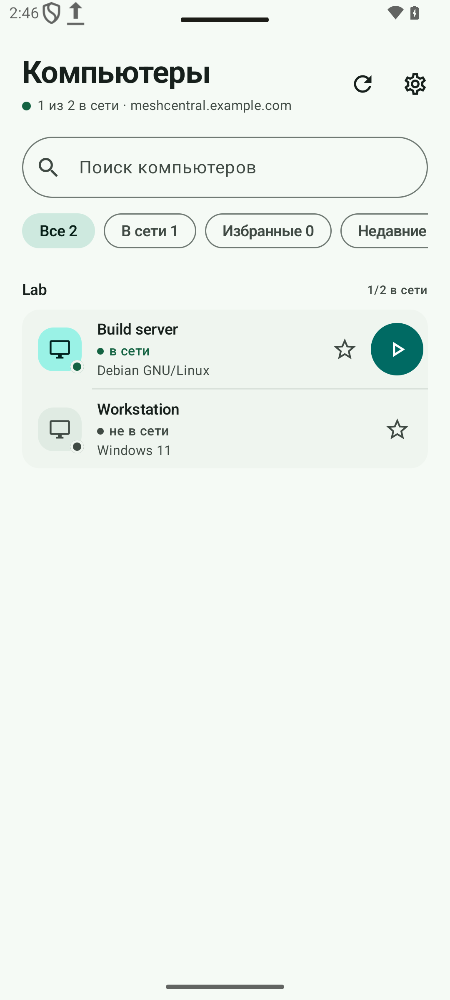
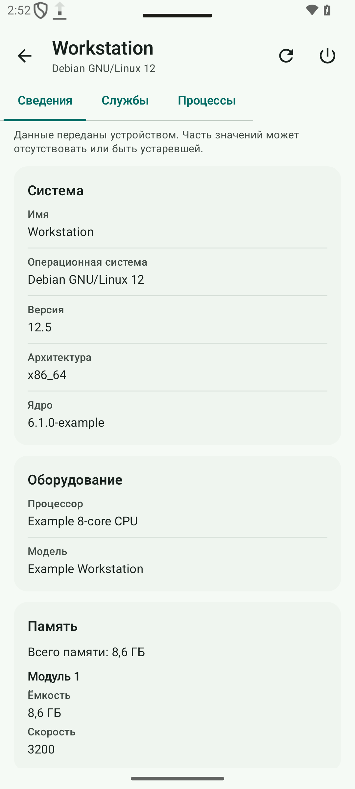
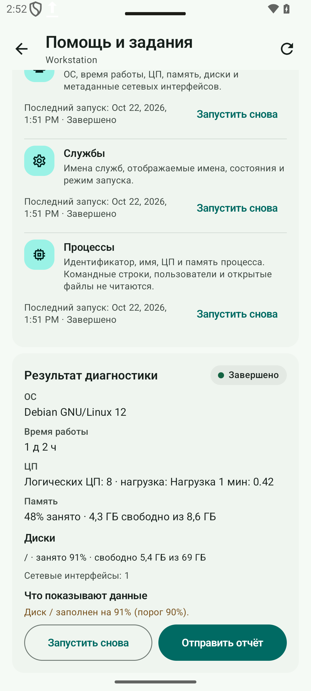

<h1 align="center"></h1>

<p align="center"><a href="README.md">English</a> · <a href="README.zh-CN.md">简体中文</a> · <a href="README.ru.md"><strong>Русский</strong></a></p>

<p align="center"><strong>Независимый Android-клиент для вашего сервера MeshCentral: компьютеры, рабочий стол, терминал, файлы, SSH и SFTP с телефона или планшета.</strong></p>

<p align="center">
  <a href="https://github.com/papajon123/meshcentral-android/releases"><strong>Скачать APK</strong></a>
</p>

<p align="center">
  <a href="https://github.com/papajon123/meshcentral-android/releases"></a>
  
  
  
</p>

> **Версия 0.7.0**: профили серверов, два сеанса, отправка файлов и необязательные серверные задания. Подробнее — в [истории изменений](CHANGELOG.md).

## Скриншоты

<p align="center">
  
  
  
</p>

<p align="center"><sub>Демонстрационные экраны приложения с вымышленными данными. Интерфейс показан на английском; имена устройств и файлов не переводятся автоматически.</sub></p>

## Быстрый старт

1. **Установите приложение.** Скачайте [подписанный APK](https://github.com/papajon123/meshcentral-android/releases). Нужен Android 8.0 (API 26) или новее. Встроенного обновления в публичной сборке нет.
2. **Сохраните подпись.** Android примет обновление только с тем же именем пакета, тем же ключом подписи и большим `versionCode`.
3. **Подключите свой сервер.** Введите полный HTTPS-адрес вашего MeshCentral, например `https://meshcentral.example.com/`, и войдите с учётной записью MeshCentral. Сервер и учётная запись не предустановлены. Браузерный SSO не поддерживается. Для терминала установите актуальный Android System WebView.

## Что можно делать

### Устройства, поиск и профили

- Просматривать группы и компьютеры, фильтровать по доступности или избранному, видеть ОС, адрес и версию Agent.
- Искать по загруженному списку: имя устройства, группа, узел/IP или ОС. Запрос нормализуется по Unicode и не зависит от регистра; каждое слово должно совпасть (AND). Ввод не отправляет запрос на сервер.
- Хранить до 20 недавно открытых компьютеров на профиль и учётную запись. Ключ области хешируется; имена устройств и адреса в списке недавних не сохраняются.
- Держать несколько профилей серверов (до 20) с отдельными адресами, учётными данными, избранным и недавними устройствами. Первый профиль переносится из текущих настроек. Учётные данные и избранное привязаны к профилю; PIN и настройки приватности остаются общими. Переключение и удаление профиля закрывают его сеансы.

### Сеансы и удалённые инструменты

- Одновременно открыты **два сеанса**: рабочий стол плюс инструмент или два инструмента. Третий сеанс не открывается, пока один не закрыт явно.
- Выбранные устройство и вкладка переживают пересоздание Activity; после смерти процесса восстанавливается выбор, а не фиктивное живое соединение. Ввод, команды и изменения файлов автоматически не повторяются.
- Рабочий стол: просмотр и управление с помощью касаний, тачпада, клавиатуры, текстового буфера, переключения мониторов и переподключения.
- Терминал: команды в оболочке Agent. Файлы: просмотр, скачивание в документ, загрузка, создание папок, переименование и удаление. SSH и SFTP: работа через серверные релеи.
- Стандартные рабочий стол, терминал, файлы, SSH и SFTP **не требуют серверного плагина**. Вкладки следуют возможностям, которые сообщает сервер: известный запрет отключает вкладку, отсутствие необязательных данных допускает явную попытку. Решение принимает сервер.

### «Поделиться» на компьютер

- Принимаются `ACTION_SEND` и `ACTION_SEND_MULTIPLE` из файлового менеджера, галереи или почты, до **20** документов `content://`.
- Выберите профиль, компьютер и папку; загрузка идёт через видимую очередь. У каждой строки своё состояние, прогресс, отмена и явный повтор.
- Загрузки проверяются обратным чтением SHA-256. Неудачная или отменённая передача не показывается как успешная. Повтор начинается **с начала**: скрытой докачки и обещаний смещения нет.
- URI источника хранится только в памяти. После смерти процесса файл нужно выбрать заново. Foreground-служба data-sync удерживает активную очередь, пока Android это разрешает.

### Система, службы и питание

- Система, диски, память и сеть читаются из данных, которые MeshCentral уже хранит для устройства. Отсутствующие данные остаются неизвестными, а не нулём.
- С необязательным плагином доступны списки служб и процессов. Подтверждённый запуск, остановка и перезапуск службы возможны только там, где это поддерживают Agent, ОС и права пользователя; результат проверяется повторно.
- Перезагрузка, выключение и Wake-on-LAN предлагаются только при подходящих правах и состоянии сети. ACK сервера не считается выполнением: приложение опрашивает устройство и сообщает «переподключилось», «осталось offline» или «неизвестно».

### Задания, история и «Быстрая помощь»

- Разрешены только фиксированные шаблоны из allowlist: `diagnostics`, `services`, `processes`, `service-start`, `service-stop`, `service-restart`. Произвольной оболочки или пользовательских команд нет.
- У задания есть статус, результат, код завершения и ограниченный вывод. Сервер хранит историю 7 дней, не более 40 заданий и 64 KiB вывода на задание. `operationId` предотвращает скрытый повтор; выполняющееся задание нельзя отменить, и приложение не утверждает, что процесс был убит.
- «Быстрая помощь»: диагностика → объяснение → подтверждённое действие → повторная проверка → краткий отчёт. В отчёт не попадают имя устройства, IP, пользователь, hostname, id узла/задания и сырой вывод. Неизвестная причина остаётся неизвестной.

### Необязательные уведомления

- Фоновые уведомления работают через WorkManager с интервалом **15 минут** (best effort), тихими часами и фильтрами по типам. FCM, собственного push-сервиса и постоянного сокета нет.
- После явного включения приложение хранит read-only bearer-токен в Android Keystore (TTL 30 дней) и опрашивает HTTPS-endpoint того же origin. Cookie, redirect, query-токен и исключение для самоподписанного сертификата на этом пути отклоняются.
- Повторные и устаревшие события фильтруются; нажатие на уведомление после разблокировки открывает нужный профиль, устройство или задание. Неудачный online-отзыв токена показывается как ограничение, а не как успех.

## Необязательный серверный плагин

Задания, службы и процессы, подтверждённые действия со службами и фоновые уведомления используют необязательный плагин **`mobilecompanion` 1.1.0**. Стандартные рабочий стол, терминал, файлы, SSH и SFTP работают без него.

- Нужны MeshCentral **1.3.0** и право пользователя `MESHRIGHT_REMOTECOMMAND (0x20000)`. Права **24** (agent console) недостаточно.
- Плагин предоставляет фиксированные шаблоны, задания с проверкой ACL, read-only HTTP-события и токены уведомлений. Он не патчит ядро MeshCentral и не принимает произвольный код или строки shell.
- Приложение **не устанавливает**, не настраивает, не разворачивает и не администрирует MeshCentral или плагин. [Пакет плагина и его README](server/mobile-companion/README.md) отделены от APK.
- Живая приёмка шла на изолированном реальном MeshCentral 1.3.0 с Linux Agent. Действия со службами Windows Agent и systemd ещё не проверены. Multi-server MeshCentral этой версией плагина не поддерживается.

## Проверки и ограничения

- Публичная сборка проверена локально: 240 модульных тестов; на API 35 — 135 успешных проверок и 4 пропуска отдельных сценариев, без ошибок. Получены снимки разных языков, RTL, шрифта ×2 и планшета. См. [реализацию и ограничения](docs/ROADMAP_IMPLEMENTATION.md).

- Не проверены: физический телефон, реальный Windows Mesh Agent, действия со службами через systemd, TalkBack, крупный шрифт на устройстве, расход батареи, ограничения Doze/OEM и все сценарии 0.7.0 на Android 8.
- Приёмка на телефоне должна покрыть установку/обновление поверх подписанной сборки, вход и 2FA, два сеанса, поворот/фон/блокировку/потерю сети/смерть процесса, отправку из реальных приложений, уведомления и необязательный плагин.
- WebRTC в этом выпуске нет. Технология исследована, но MeshCentral 1.3.0 не принимает terminal RTC offer; остаётся WSS-релей. См. [план развития](docs/ROADMAP.md).
- Intel AMT KVM, RDP, VNC, чат, управление реестром и программами, администрирование сервера остаются в веб-панели. Приложение не администрирует сервер.

## Языки

- **22 языка в 23 вариантах локали Android** (упрощённый и традиционный китайский — два варианта одного языка). В каждом варианте 979 переведённых строк плюс общее название приложения.
- Android 8–12 следует языку системы. На Android 13 и новее доступны системные настройки языка приложения; отдельного выбора языка внутри приложения нет.
- Если подходящего языка нет, приложение переходит на английский. Арабский, персидский и урду используют направление справа налево.
- Переводы машинные (DeepSeek) и не вычитаны носителями всех языков. Сообщения сервера, имена устройств и файлов, вывод терминала и подписи физических клавиш не переводятся.

## Установка и обновление

Скачайте подписанный APK со страницы [GitHub Releases](https://github.com/papajon123/meshcentral-android/releases) и установите вручную. Для обновления нужны то же имя пакета, тот же ключ подписи и больший `versionCode`. Ранние приватные сборки используют другое имя пакета; это отдельные приложения, они не делят данные и ключ подписи.

## Приватность и безопасность

- Без рекламы, аналитики, телеметрии, SDK отчётов о сбоях и собственной серверной части проекта. Приложение подключается только к указанному вами серверу MeshCentral.
- Учётные данные MeshCentral и PIN приложения защищены ключом Android Keystore. Резервное копирование Android и перенос между устройствами отключены; cookie сеанса остаются в памяти процесса и очищаются в **Настройки → Данные**.
- Блокировка приложения необязательна (PIN, биометрия Android 9+ или оба способа). Блокировка скриншотов по умолчанию выключена и не защищает от камеры.
- Учётные данные профиля привязаны к его серверу. Токен уведомлений read-only, хранится в Keystore и отзывается; отчёты «Быстрой помощи» очищаются перед отправкой.
- Оператор сервера видит метаданные подключения, активность устройств и сеансов и трафик через сервер. Серверные журналы, запись терминала и управление доступом — вне приложения.

См. [Приватность](PRIVACY.md) и [Политику безопасности](SECURITY.md).

## Документация

- [План развития и статус выпуска](docs/ROADMAP.md) · [История изменений](CHANGELOG.md)
- [Архитектура](docs/ARCHITECTURE.md) · [Протокол управления и рабочего стола](docs/PROTOCOL.md)
- [Интерфейс](docs/UI.md) · [Проверка](docs/VALIDATION.md) · [Известные ограничения](docs/KNOWN_LIMITATIONS.md)
- [Необязательный серверный плагин](server/mobile-companion/README.md)
- [Приватность](PRIVACY.md) · [Политика безопасности](SECURITY.md) · [Участие](CONTRIBUTING.md)

<details>
<summary>Сборка из исходников</summary>

Требования: JDK 17, Android SDK platform 35, build-tools 35.0.0. Gradle wrapper скачает Gradle 8.10.2.

```bash
export JAVA_HOME=/path/to/jdk-17
export ANDROID_HOME="$HOME/Android/Sdk"
./gradlew testDebugUnitTest lintDebug assembleDebug
python3 ci/check_translations.py
```

В Windows используйте `.\gradlew.bat` и задайте те же переменные среды. Отладочный APK появится в `app/build/outputs/apk/debug/app-debug.apk`. Локально собранный APK не становится публичным выпуском; подписывает и публикует выпуски сопровождающий проекта.

</details>

<details>
<summary>Идентичность выпуска и подпись</summary>

- ID приложения: `io.github.papajon123.meshcentral`
- Отладочные сборки добавляют суффикс `.debug`.
- Полный SHA-256 публичного сертификата подписи:

<code>5458084705359e0d<wbr>fa9cbb83ed73a0d77<wbr>c7758370cffe2a7d<wbr>6b036e9275eeb2f</code>

Те же значения хранятся в [ci/release-identity.json](ci/release-identity.json).

</details>

## Лицензия

Apache License 2.0. См. [LICENSE](LICENSE), [NOTICE](NOTICE) и [THIRD_PARTY_NOTICES.md](THIRD_PARTY_NOTICES.md).
