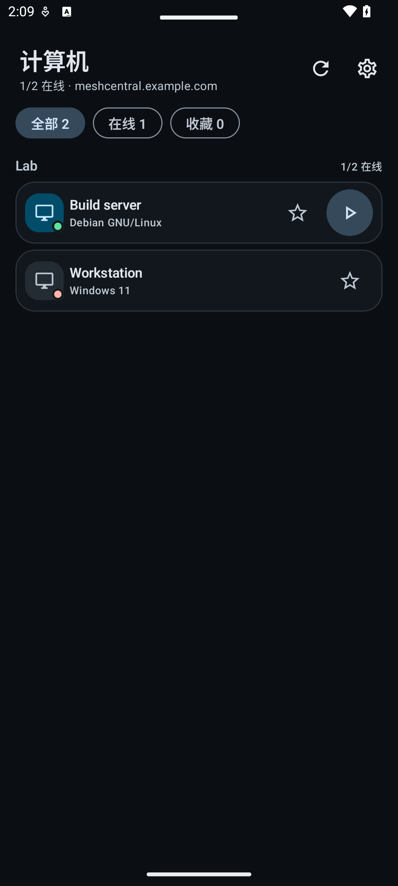
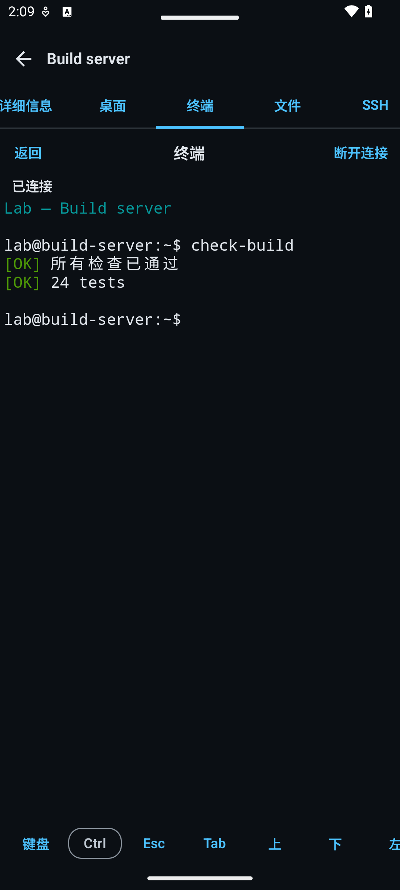
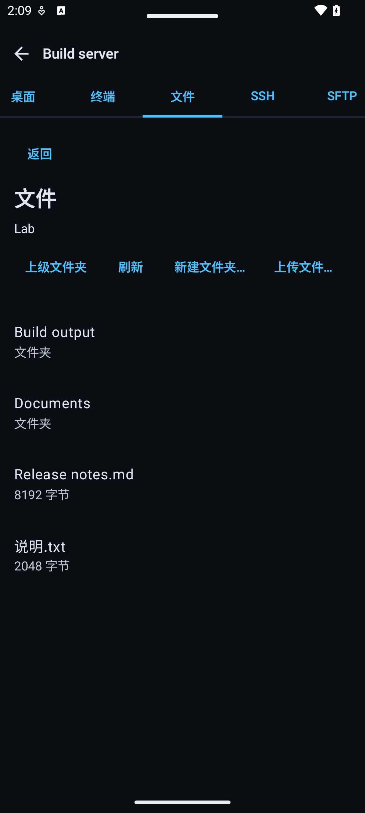

<h1 align="center"></h1>

<p align="center"><a href="README.md">English</a> · <a href="README.zh-CN.md"><strong>简体中文</strong></a> · <a href="README.ru.md">Русский</a></p>

<p align="center"><strong>面向你自己的 MeshCentral 服务器的独立 Android 客户端：在手机或平板上查看计算机，并使用桌面、终端、文件、SSH 和 SFTP。</strong></p>

<p align="center">
  <a href="https://github.com/papajon123/meshcentral-android/releases"><strong>下载 APK</strong></a>
</p>

<p align="center">
  <a href="https://github.com/papajon123/meshcentral-android/releases"></a>
  <a href="https://github.com/papajon123/meshcentral-android/releases"></a>
  <a href="https://github.com/papajon123/meshcentral-android/stargazers"></a>
  <a href="https://github.com/papajon123/meshcentral-android/graphs/contributors"></a>
</p>
<p align="center">
  
  
  
  <a href="https://github.com/papajon123/meshcentral-android/actions/workflows/android.yml"></a>
</p>

## 截图

<p align="center">
  
  
  
</p>

<p align="center"><sub>使用虚构数据在应用中实际渲染的演示截图。界面为中文；设备和文件名不会自动翻译。</sub></p>

## 快速开始

1. **安装应用。** 下载[已签名 APK](https://github.com/papajon123/meshcentral-android/releases)。需要 Android 8.0（API 26）或更高版本。
2. **允许安装并保持签名一致。** Android 会询问是否允许从你使用的浏览器或文件管理器安装。更新必须使用相同的包名、相同的签名密钥和更高的 `versionCode`。
3. **连接你自己的服务器。** 输入 MeshCentral 服务器的完整 HTTPS 地址，例如 `https://meshcentral.example.com/`，然后使用 MeshCentral 账户登录。应用没有预置服务器或账户。不支持浏览器 SSO。使用终端前，请安装最新版 Android System WebView。参见[首次启动设置界面](docs/screenshots/zh-CN/setup.png)。

## 可以做什么

| 工具 | 可以做什么 | 需要什么 |
|---|---|---|
| [设备](docs/UI.md#device-details-and-tool-tabs) | 浏览分组和计算机，按在线状态或收藏筛选，并查看操作系统、地址和 Agent 版本。 | 对该设备的访问权限 |
| 桌面 | 通过触摸、触控板、键盘、剪贴板文本查看和控制 Agent 桌面，切换显示器并重新连接。 | 在线 Agent 和桌面权限 |
| 终端 | 在 Agent 命令行中运行命令。 | 最新版 Android System WebView 和终端权限 |
| 文件 | 浏览、下载并保存为文档、上传、新建文件夹、重命名和删除。 | 在线 Agent 和文件权限 |
| SSH | 通过 MeshCentral 使用 SSH 终端。 | 服务器启用 SSH 功能，并具备 SSH 凭据 |
| SFTP | 通过服务器端 SFTP 浏览和传输文件。 | 服务器启用 SFTP 功能，并具备设备权限 |

标签页会根据可用能力显示：明确拒绝时会禁用标签页；缺少可选数据时允许显式尝试，最终由服务器决定。同一时间只打开一个桌面、终端或文件工具。终端和文件会话不会自动重连，也不会重放输入或文件更改。

## 预览版限制

这是预览版，不是稳定版，也不是完整的 MeshCentral 客户端。

- **并非完整功能。** Intel AMT KVM、RDP、VNC 和 WebRTC、设备事件、唤醒/电源、聊天、注册表/软件管理及服务器管理仍需在网页面板中完成。**打开网页面板**会在浏览器中打开服务器地址，需要单独登录。
- **尚未在所有环境验收。** 检查使用 npm MeshCentral 1.2.5、真实隔离的 Linux Mesh Agent 和 SSH/SFTP 主机。尚未在物理手机、Windows Mesh Agent、Windows Agent 工具、受限权限账户和实时同意/拒绝流程上验收。未将 MeshCentral 1.2.6 作为服务器运行，因此不声明与其兼容。
- **服务器策略仍由服务器决定。** SSH 由 MeshCentral 终止；应用不声明在 Android 上进行主机密钥固定。服务器可能记录桌面、终端、SSH/SFTP 或文件活动；应用内没有提示并不证明未记录。
- **网络要求。** 应用需要通过 HTTPS/WSS 连接你的服务器，反向代理必须允许 WebSocket 升级。不支持浏览器 SSO、`?key=` URL 访问密钥和服务器管理；子路径部署仍需实测。
- **终端。** 需要可用的最新版 Android System WebView。工具会话是一次性的：不会自动重连，也不会重放之前的输入。本地渲染器无法启动时，应用会显示更新或重新打开的提示。
- **文件。** 不支持断点续传或自动重试。下载失败或被取消时，可能在你选择的位置留下不完整文件；应用会报告该结果，但不会删除文件。取消尚未确认的新建文件夹、重命名或删除操作时，会显示为“未验证”。
- **翻译。** 应用由机器翻译（DeepSeek）生成，尚未经过所有语言的母语者校对。

## 语言

界面提供 **22 种语言、23 个 Android 区域变体**。简体中文和繁体中文算作一种语言、两个变体。

- Android 8–12 自动跟随系统语言。Android 13 及更高版本还会出现在系统的应用单独语言设置中；应用内没有单独的语言选择器。
- 如果没有匹配的受支持语言，应用回退到英文。阿拉伯语、波斯语和乌尔都语使用从右到左的布局。
- 每个变体包含相同的 529 条翻译字符串，应用名称共用。
- 服务器消息、设备和文件名、终端输出以及物理按键说明不会翻译。

English, русский, 简体中文, 繁體中文, español, français, português, Deutsch, العربية, हिन्दी, বাংলা, اردو, 日本語, 한국어, Bahasa Indonesia, Türkçe, Tiếng Việt, ไทย, italiano, فارسی, தமிழ், తెలుగు, मराठी.

## 常见问题

### 如何更新？
从 [GitHub Releases](https://github.com/papajon123/meshcentral-android/releases) 下载新的 APK 并手动安装。应用内没有更新器。Android 只接受包名相同、签名密钥相同且 `versionCode` 更高的更新。公开版本使用同一签名密钥；早期私有版本是单独的应用。

### 需要 GitHub Packages 吗？
不需要。应用从 GitHub Releases 安装。GitHub Packages 用于库和容器，不能替代 APK。

### APK 由哪个证书签名？
公开包名为 `io.github.papajon123.meshcentral`。签名证书的完整 SHA-256 见下方的发行身份部分和 [ci/release-identity.json](ci/release-identity.json)。不要用其他密钥签名的构建覆盖安装此版本。

### 旧的私有构建怎么办？
早期的私有构建使用不同的包名，仍是独立应用。它们无法更新到此公开版本，也不共享数据或签名密钥。请先备份需要的内容，再单独安装公开应用。

## 验证

0.5.1 已通过 **170 个 JVM 测试**和 API 35 上的 **66 个常规 Android 测试**，另有 7 个 Android 测试按预期跳过。基于 npm MeshCentral 1.2.5 的 6 个真实场景分两次运行确认：一次在 Activity 启动前读取测试环境数据时发生 `ProtocolException`，随后单独重跑成功。这并非一次全部通过的真实场景运行。证据及未测试环境见[验证](docs/VALIDATION.md)和[已知限制](docs/KNOWN_LIMITATIONS.md)。

## 隐私与安全

- 无广告、分析、遥测、崩溃报告 SDK 或项目自建后端。应用只连接你配置的 MeshCentral 服务器。
- MeshCentral 凭据和应用 PIN 由 Android Keystore 密钥保护。Android 备份和设备迁移已禁用；会话 Cookie 仅保存在进程内存中，可在**设置 → 数据**中清除。
- 应用锁为可选功能（PIN、Android 9+ 生物识别，或两者）。阻止截屏功能默认关闭，也不能阻止相机拍摄。
- 服务器运营者可以看到连接元数据、设备和会话活动，以及经过服务器的流量。服务器日志、终端录制和访问控制不在应用范围内。

阅读[隐私说明](PRIVACY.md)和[安全策略](SECURITY.md)。

## 贡献者与参与

<p align="center">
  <a href="https://github.com/papajon123"></a>
  <br>
  <a href="https://github.com/papajon123">papajon123</a>
  <br>
  <a href="https://github.com/papajon123/meshcentral-android/graphs/contributors">贡献者图表</a>
</p>

欢迎有明确证据、小而专注的改动。请阅读[参与指南](CONTRIBUTING.md)；大幅重构或协议改动前先开 issue；不要发布凭据、会话 Cookie、私钥、真实服务器名称或未脱敏日志。安全问题请通过 [SECURITY.md](SECURITY.md) 中的私下渠道报告。

## 文档

- [架构](docs/ARCHITECTURE.md) · [控制与桌面协议](docs/PROTOCOL.md)
- [界面](docs/UI.md) · [验证](docs/VALIDATION.md)
- [已知限制](docs/KNOWN_LIMITATIONS.md) · [路线图](docs/ROADMAP.md)
- [隐私](PRIVACY.md) · [安全策略](SECURITY.md)
- [参与指南](CONTRIBUTING.md) · [变更日志](CHANGELOG.md)

<details>
<summary>从源码构建</summary>

要求：JDK 17、Android SDK platform 35、build-tools 35.0.0。Gradle wrapper 会下载 Gradle 8.10.2。

```bash
export JAVA_HOME=/path/to/jdk-17
export ANDROID_HOME="$HOME/Android/Sdk"
./gradlew assembleDebug
```

Windows 上使用 `.\gradlew.bat`，并设置相同的环境变量。调试 APK 输出到 `app/build/outputs/apk/debug/app-debug.apk`。

检查：

```bash
./gradlew testDebugUnitTest lintDebug assembleDebug
python3 ci/check_translations.py
```

本地构建的 APK 不是公开发行版；维护者负责签名和发布。

</details>

<details>
<summary>发行身份与签名</summary>

- 应用 ID：`io.github.papajon123.meshcentral`
- 调试构建会添加 `.debug` 后缀。
- 公开签名证书的完整 SHA-256：

<code>5458084705359e0d<wbr>fa9cbb83ed73a0d77<wbr>c7758370cffe2a7d<wbr>6b036e9275eeb2f</code>

相同值保存在 [ci/release-identity.json](ci/release-identity.json)。

</details>

## 许可证

Apache License 2.0。参见 [LICENSE](LICENSE)、[NOTICE](NOTICE) 和 [THIRD_PARTY_NOTICES.md](THIRD_PARTY_NOTICES.md)。
