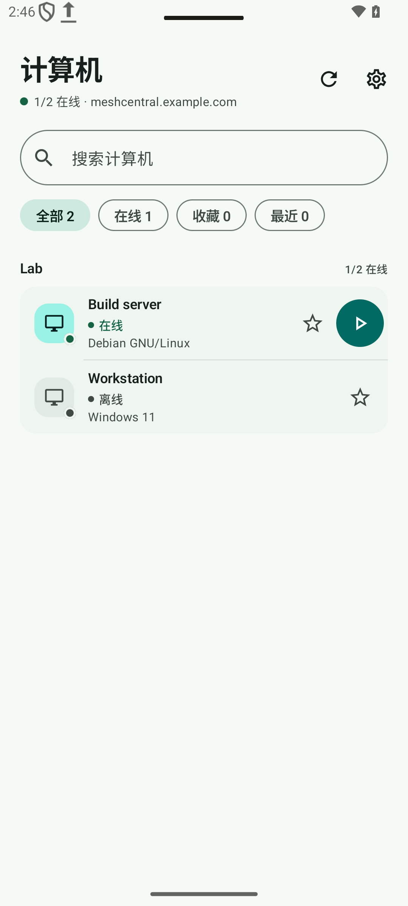
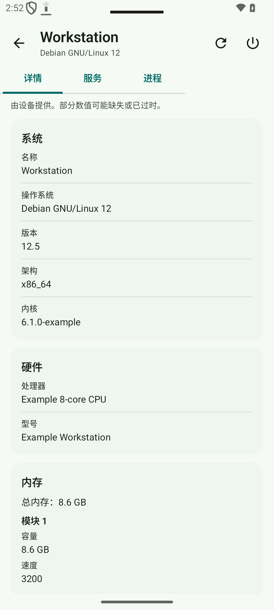
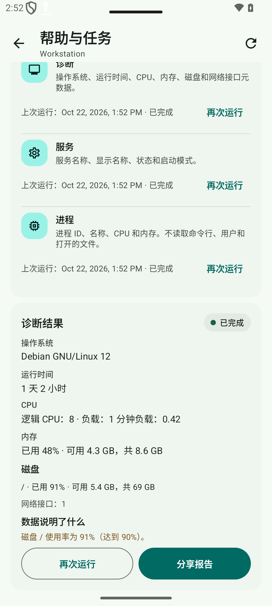

<h1 align="center"></h1>

<p align="center"><a href="README.md">English</a> · <a href="README.zh-CN.md"><strong>简体中文</strong></a> · <a href="README.ru.md">Русский</a></p>

<p align="center"><strong>面向你自己的 MeshCentral 服务器的独立 Android 客户端：在手机或平板上查看计算机，并使用桌面、终端、文件、SSH 和 SFTP。</strong></p>

<p align="center">
  <a href="https://github.com/papajon123/meshcentral-android/releases"><strong>下载 APK</strong></a>
</p>

<p align="center">
  <a href="https://github.com/papajon123/meshcentral-android/releases"></a>
  
  
  
</p>

> **0.7.0 版本**新增服务器配置、双会话、文件分享和可选服务器任务。详见[更新日志](CHANGELOG.md)。

## 截图

<p align="center">
  
  
  
</p>

<p align="center"><sub>使用虚构数据在应用中实际渲染的演示界面。界面为英文；设备和文件名不会自动翻译。</sub></p>

## 快速开始

1. **安装应用。** 从 [GitHub Releases](https://github.com/papajon123/meshcentral-android/releases) 下载[已签名 APK](https://github.com/papajon123/meshcentral-android/releases)。需要 Android 8.0（API 26）或更高版本。公开版本没有应用内更新器。
2. **保持签名一致。** Android 只接受包名相同、签名密钥相同且 `versionCode` 更高的更新。
3. **连接你自己的服务器。** 输入 MeshCentral 服务器的完整 HTTPS 地址，例如 `https://meshcentral.example.com/`，然后使用 MeshCentral 账户登录。应用没有预置服务器或账户。不支持浏览器 SSO。使用终端前，请安装最新版 Android System WebView。

## 可以做什么

### 设备、搜索和配置文件

- 浏览分组和计算机，按在线状态或收藏筛选，并查看操作系统、地址和 Agent 版本。
- 在已加载列表中按设备名、分组、主机/IP 或操作系统搜索。查询按 Unicode 规范化且不区分大小写；每个词都必须匹配（AND）。输入不会向服务器发送请求。
- 每个配置文件和账户保留最多 20 台最近打开的计算机。作用域键经过哈希；最近列表不保存设备名和地址。
- 保留多个服务器配置文件（最多 20 个），各自拥有地址、凭据、收藏和最近设备。第一个配置文件由现有设置迁移而来。凭据和收藏按配置文件隔离；应用 PIN 和隐私开关保持全局。切换或删除配置文件会关闭其会话。

### 会话和远程工具

- 同时保留**两个会话**：一个桌面加一个工具，或两个工具。在明确关闭一个会话之前，不会打开第三个。
- 选中的设备和标签页在 Activity 重建后保留；进程被终止后恢复的是用户选择，而不是虚假的活动连接。输入、命令和文件更改不会自动重放。
- 桌面：通过触摸、触控板、键盘、剪贴板文本、显示器切换和重新连接来查看和控制 Agent 桌面。
- 终端：在 Agent shell 中运行命令。文件：浏览、下载为文档、上传、新建文件夹、重命名和删除。SSH 和 SFTP：通过服务器端中继工作。
- 标准桌面、终端、文件、SSH 和 SFTP **不需要服务器插件**。标签页遵循服务器报告的能力：明确拒绝会禁用标签页；缺少可选数据时允许显式尝试。最终由服务器决定。

### 分享到计算机

- 接受来自文件管理器、相册或邮件应用的 `ACTION_SEND` 和 `ACTION_SEND_MULTIPLE`，最多 **20** 个 `content://` 文档。
- 选择配置文件、计算机和文件夹，然后通过可见队列上传。每一行都有自己的状态、进度、取消和显式重试。
- 上传通过回读 SHA-256 校验。失败或取消的传输绝不会显示为成功。重试**从头开始**；没有隐藏的断点续传或偏移量声明。
- 源 URI 仅保存在内存中。进程被终止后需要重新分享文件。前台 data-sync 服务会在 Android 允许的范围内维持活动队列。

### 系统、服务和电源

- 读取 MeshCentral 已为该设备保存的系统、磁盘、内存和网络数据。缺失数据保持未知，不会显示为零。
- 使用可选插件可列出服务和进程。只有在 Agent、操作系统和用户权限支持时，才能确认启动、停止或重启服务；操作后会再次检查结果。
- 仅当报告的权利和在线状态允许时，才提供重启、关机和 Wake-on-LAN。服务器 ACK 不等于已执行：应用会轮询并报告“已重新连接”“仍离线”或“未知”。

### 任务、历史和快速帮助

- 只运行固定的白名单模板：`diagnostics`、`services`、`processes`、`service-start`、`service-stop`、`service-restart`。不支持任意 shell 或用户提供的命令。
- 任务保留状态、结果、退出码和有界输出。服务器保留 7 天历史、最多 40 个任务、每个任务最多 64 KiB 输出。`operationId` 防止静默重复；运行中的任务无法取消，应用不会声称已终止进程。
- 快速帮助流程：诊断 → 解释 → 确认操作 → 再次检查 → 简短报告。可分享的报告不包含设备名、IP、用户、主机名、节点/任务 ID 和原始输出。未知原因保持未知。

### 可选通知

- 可选后台通知使用 WorkManager，间隔为 **15 分钟**（尽力而为），支持免打扰时段和按类型过滤。没有 FCM、没有项目推送服务，也没有常驻套接字。
- 用户显式启用后，应用在 Android Keystore 中保存只读 Bearer 令牌（30 天 TTL），并轮询同源 HTTPS 端点。该路径拒绝 Cookie、重定向、查询参数令牌和自签名证书例外。
- 重复和过期事件会被过滤；解锁后点击通知会跳转到正确的配置文件、设备或任务。在线撤销失败会显示为限制，而不是成功。

## 可选服务器插件

任务、服务和进程视图、确认的服务操作以及后台通知使用可选的 **`mobilecompanion` 1.1.0** 插件。标准桌面、终端、文件、SSH 和 SFTP 无需该插件。

- 需要 MeshCentral **1.3.0** 和用户权限 `MESHRIGHT_REMOTECOMMAND (0x20000)`。**24**（Agent 控制台）权限不够。
- 插件提供固定模板、经 ACL 检查的任务、只读 HTTP 事件和通知令牌。它不修改 MeshCentral 核心，也不接受任意代码或 shell 字符串。
- 应用**不安装**、不配置、不部署也不管理 MeshCentral 或插件。[插件包及其 README](server/mobile-companion/README.md) 与 APK 分开提供。
- 实机验收使用隔离的真实 MeshCentral 1.3.0 和 Linux Agent。Windows Agent 和 systemd 服务操作尚未测试。此插件版本不支持多服务器 MeshCentral。

## 验证和限制

- 公开版本已通过本地构建和 240 项 JVM 测试；API 35：135 项通过、4 项可选或兼容性测试跳过、0 项失败。已生成多语言、RTL、双倍字体和平板截图。
- 未验证：物理手机、真实 Windows Mesh Agent、systemd 服务操作、TalkBack、设备上的大字体、电池消耗、Doze/OEM 后台限制，以及 Android 8 上的全部 0.7.0 流程。
- 手机验收仍需覆盖：在已签名版本上安装/更新、登录/2FA、两个会话、旋转/后台/锁屏/断网/进程终止、从真实应用分享、通知和可选插件。
- 本版本不包含 WebRTC。该技术已调研，但 MeshCentral 1.3.0 不接受终端 RTC offer；继续使用 WSS 中继。参见[路线图](docs/ROADMAP.md)。
- Intel AMT KVM、RDP、VNC、聊天、注册表/软件管理和服务器管理仍在网页面板中。应用不管理服务器。

## 语言

- **22 种语言、23 个 Android 区域变体**（简体中文和繁体中文是同一种语言的两个变体）。每个变体有 979 条翻译字符串，外加共享的应用名称。
- Android 8–12 跟随系统语言。Android 13 及更高版本还提供应用单独语言设置；应用内没有单独的语言选择器。
- 如果没有匹配的受支持语言，应用回退到英文。阿拉伯语、波斯语和乌尔都语使用从右到左布局。
- 翻译由机器生成（DeepSeek），尚未经过所有语言的母语者校对。服务器消息、设备和文件名、终端输出及物理按键说明不会翻译。

## 安装和更新

从 [GitHub Releases](https://github.com/papajon123/meshcentral-android/releases) 下载已签名 APK 并手动安装。更新需要相同的包名、相同的签名密钥和更高的 `versionCode`。早期非公开构建使用不同的包名；它们是独立应用，不共享数据或签名密钥。

## 隐私与安全

- 无广告、分析、遥测、崩溃报告 SDK 或项目自建后端。应用只连接你配置的 MeshCentral 服务器。
- MeshCentral 凭据和应用 PIN 由 Android Keystore 密钥保护。Android 备份和设备迁移已禁用；会话 Cookie 仅保存在进程内存中，可在**设置 → 数据**中清除。
- 应用锁为可选功能（PIN、Android 9+ 生物识别，或两者）。阻止截屏默认关闭，也不能阻止相机拍摄。
- 配置文件凭据绑定到其服务器。通知令牌为只读、由 Keystore 保护且可撤销；快速帮助报告在分享前会脱敏。
- 服务器运营者可以看到连接元数据、设备和会话活动，以及经过服务器的流量。服务器日志、终端录制和访问控制不在应用范围内。

阅读[隐私说明](PRIVACY.md)和[安全策略](SECURITY.md)。

## 文档

- [路线图和发布状态](docs/ROADMAP.md) · [变更日志](CHANGELOG.md)
- [架构](docs/ARCHITECTURE.md) · [控制与桌面协议](docs/PROTOCOL.md)
- [界面](docs/UI.md) · [验证](docs/VALIDATION.md) · [已知限制](docs/KNOWN_LIMITATIONS.md)
- [可选服务器插件](server/mobile-companion/README.md)
- [隐私](PRIVACY.md) · [安全策略](SECURITY.md) · [参与指南](CONTRIBUTING.md)

<details>
<summary>从源码构建</summary>

要求：JDK 17、Android SDK platform 35、build-tools 35.0.0。Gradle wrapper 会下载 Gradle 8.10.2。

```bash
export JAVA_HOME=/path/to/jdk-17
export ANDROID_HOME="$HOME/Android/Sdk"
./gradlew testDebugUnitTest lintDebug assembleDebug
python3 ci/check_translations.py
```

Windows 上使用 `.\gradlew.bat`，并设置相同的环境变量。调试 APK 输出到 `app/build/outputs/apk/debug/app-debug.apk`。本地构建的 APK 不是公开发行版；维护者负责签名和发布。

</details>

<details>
<summary>发行身份与签名</summary>

- 应用 ID：`io.github.papajon123.meshcentral`
- 调试构建会添加 `.debug` 后缀。
- 公开签名证书的完整 SHA-256：

<code>5458084705359e0d<wbr>fa9cbb83ed73a0d77<wbr>c7758370cffe2a7d<wbr>6b036e9275eeb2f</code>

相同值保存在 [ci/release-identity.json](ci/release-identity.json)。

</details>

## 许可证

Apache License 2.0。参见 [LICENSE](LICENSE)、[NOTICE](NOTICE) 和 [THIRD_PARTY_NOTICES.md](THIRD_PARTY_NOTICES.md)。
