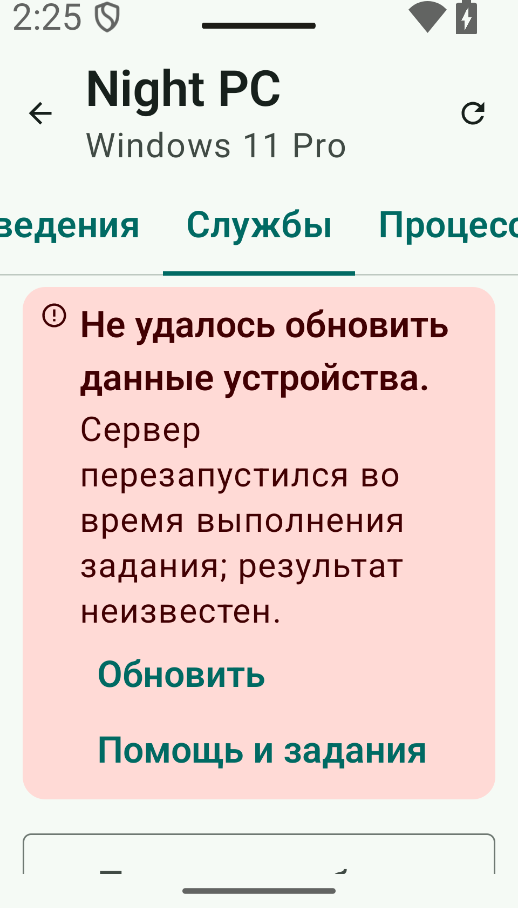
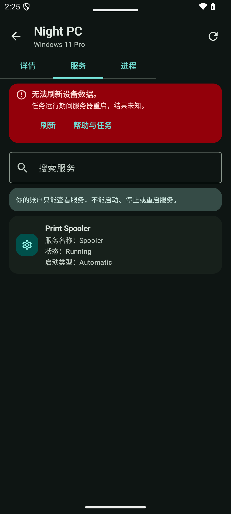
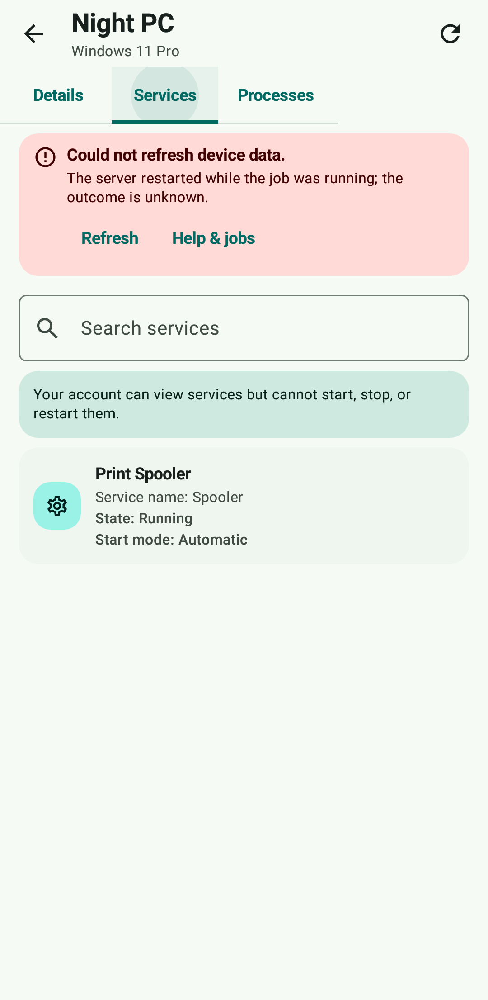

# Inspector 0.7.2: verification

The System workspace now explains known Services/Processes failures using the
existing localized Companion messages. Refresh reloads the selected tab; error
recovery offers Refresh and Help without repeating a service mutation.
Status messages scroll with the list. Dependencies, application IDs and signing
identities are unchanged. See [the interface contract](INSPECTOR_ERRORS.md).

## Local results, 23 October 2026

| Check | Result |
| --- | --- |
| JVM tests, original / public app | 258 / 250 passed; no failures or skips |
| Android Lint, both apps | No errors |
| Debug and instrumentation APKs, both apps | Built successfully |
| Inspector UI, public Android 15 / Android 8 | 10 / 10 passed |
| Inspector UI, original Android 15 | 10 passed |
| Help and jobs UI, original Android 15 / public Android 8 | 3 / 3 passed |
| Russian, font 200%, 960 x 1680 | Passed; recovery actions and service row reachable by scrolling |
| Simplified Chinese, dark theme | Passed |

Commands: `gradlew.bat testDebugUnitTest lintDebug assembleDebug assembleDebugAndroidTest -Pkotlin.incremental=false`,
then `adb -s <dedicated-emulator> shell am instrument -w -r -e class <test-class> <test-package>/androidx.test.runner.AndroidJUnitRunner`.
Test classes are `DeviceInspectorScreenTest` and `CompanionScreenTest`.
The localized scenario accepts `inspectorLocale` and `inspectorDark` arguments;
set device font scale and display size separately before invoking it.

The Russian large-font test initially queried a virtualized row before composition.
It now scrolls the tagged LazyColumn to the row and still asserts visibility.
Android 8 returned null from UiAutomation screenshot capture; tests use an actual
Compose-window capture on that device. Neither failure was skipped or suppressed.

## Screenshots and review

Images use synthetic device data. Android 15 captures come from UiAutomation;
Android 8 uses Compose window capture. An independent reviewer checked the job
runner, selected-tab refresh, recovery actions and Russian/Chinese screenshots;
no blocking finding remained. The reviewer did not claim to run these tests.

| Russian, font 200% | Chinese, dark theme | Android 8 |
| --- | --- | --- |
|  |  |  |

[Russian list after scrolling](images/inspector-0.7.2/ru-large-list.png)

## Scope and limitations

These inspector scenarios use controlled responses on real emulators; they do not
start or stop remote services. Real Windows service/process reads were verified
separately for Mobile Companion 1.1.2. Physical-phone acceptance, service mutations
on Windows/systemd, TalkBack and battery/performance measurements remain open.
Signing, published downloads and in-place installation are separate delivery checks;
local UI results alone do not establish release availability.
