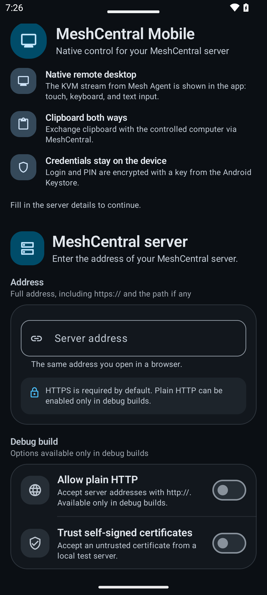
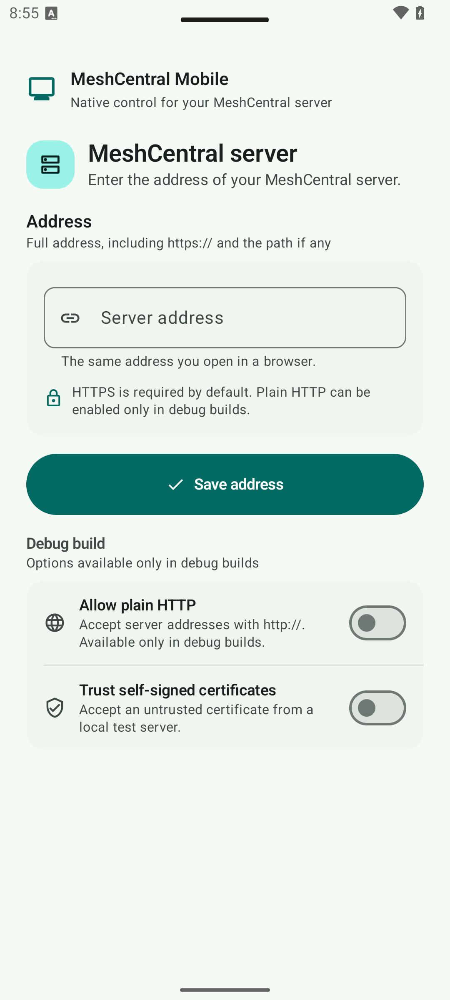
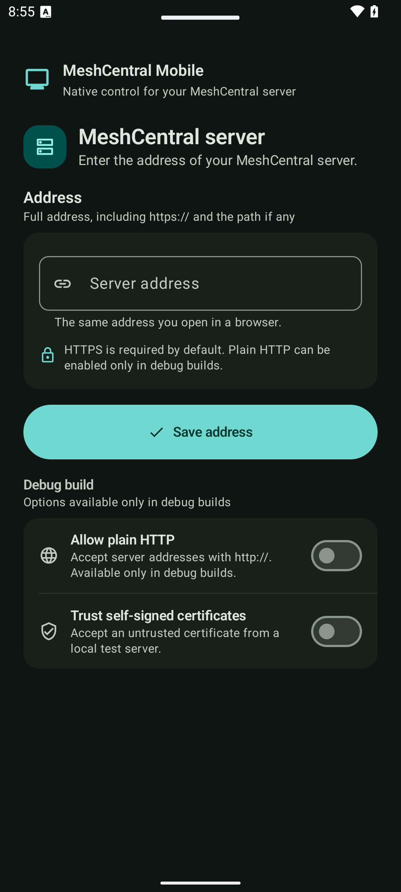
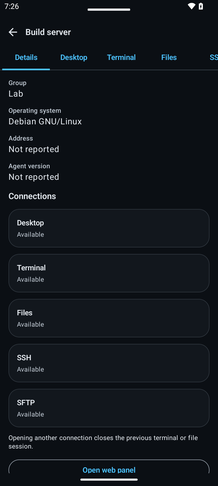
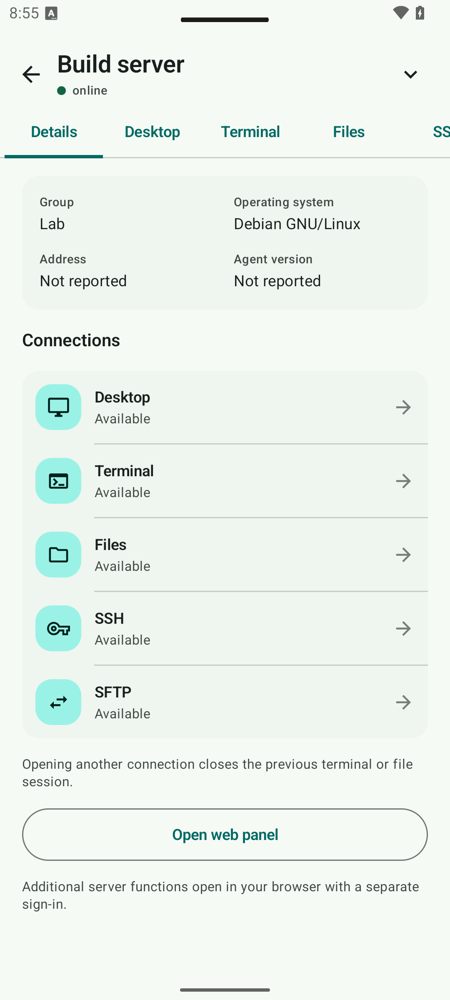
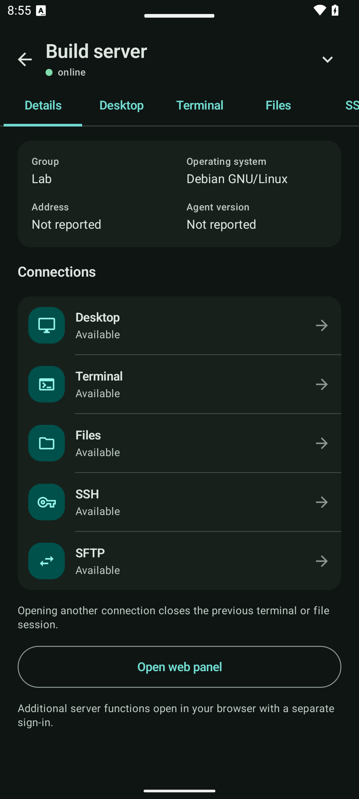

# Android interface redesign

Implemented locally on `redesign/material-expressive`, from public version 0.5.4 (`84b666f599f77fcbd200fb59c9d420290064ec7a`). This is a working debug preview, not a published release. Version code 13 and the release application ID remain unchanged. The original application variant also received the interface changes while retaining its updater.

## Interface

The [Signal design system](../../DESIGN.md) uses mineral surfaces, a teal action color and separate warning/error roles. It supports light, dark and system themes; optional wallpaper colors affect surfaces while preserving branded action and safety colors. The platform font handles Latin, Cyrillic, CJK and RTL scripts.

The direction was refined against actual [Termius](https://play.google.com/store/apps/details?id=com.server.auditor.ssh.client) and [Solid Explorer](https://play.google.com/store/apps/details?id=pl.solidexplorer2) screenshots: compact toolbars, meaningful file/device rows, and actions beside their object. Their artwork is not included in this repository. Oversized introductory panels, repeated status copy and individual cards around every tool were removed.

| Area | Implemented change |
| --- | --- |
| Setup and server settings | Compact identity, grouped address form, inline validation, scrolling around the keyboard |
| Sign-in and app lock | Clear credential/PIN hierarchy, readable errors, preserved 2FA, biometric and keypad actions |
| Computers | Grouped device rows, filters, separate favorite/connect actions, scrollable empty states, a full-width title at large font sizes |
| Device details | Structured metadata, grouped tools on phones and columns on tablets; a menu reaches every tool without scrolling the tab strip |
| Remote desktop | Compact status and controls, readable action targets, retained keyboard/pointer/clipboard/display sheets and full-screen behavior |
| Terminal and SSH | Compact connection controls, more room for output, accessible auxiliary keys and authentication controls |
| Files and SFTP | File type/size hierarchy, readable paths, wrapping actions, transfer progress and existing confirmations |
| Settings and dialogs | Appearance controls, bounded reading width, consistent surfaces and error/confirmation roles |
| Main navigation | Labelled Material navigation bar below 600 dp and rail on wider windows; the same three destinations |

Before/after examples use production Compose components with synthetic data:

| Before | After: light | After: dark |
| --- | --- | --- |
|  |  |  |
|  |  |  |

## Architecture and component rules

- `ui/theme/Color.kt`, `Type.kt`, `Shape.kt` and `Motion.kt` define the shared roles and tokens. Use semantic roles, a 4 dp spacing scale, flexible text height and touch targets of at least 48 dp.
- `MeshCard`, `SectionHeader`, `ConnectionNotice`, `EmptyState`, `MeshSheet` and the navigation components provide common states. Prefer grouped rows/dividers for related tools; reserve stronger containers for selection or an important action.
- `AppearancePreferences` uses a separate `mesh_appearance` preferences file. It does not rewrite credentials, PIN, server settings or favorites. Theme listeners and the system animation-scale observer are lifecycle scoped.
- System animation scale zero produces static progress and immediate custom motion. The remote canvas remains black in both themes.
- Existing state-based navigation and ViewModel-owned network sessions remain. No Navigation 3 migration, transport replacement or mocked production service was introduced. Back closes desktop sheets/keyboard/full-screen mode before leaving the session; Settings returns to Computers.
- The original variant's updater, installation permissions, FileProvider, server defaults and signing configuration were preserved. No server or publication changes were made.
- Kotlin 2.0.21, AGP 8.7.3, Compose BOM 2024.12.01 and Material 3 1.3.1 are unchanged. Compile/target SDK 35, minimum SDK 26 and Java/Kotlin bytecode target 17 are unchanged. Expressive design principles are implemented using compatible APIs; this does not claim an upgrade to newer experimental Material components.

## Verification

Tests ran on dedicated API 35 and API 26 emulators. The connected physical device was a TV box, not a test phone, and was left untouched. [Machine-readable results](verification.json) distinguish passed tests from assumption skips.

| Check | Result |
| --- | --- |
| Public JVM suite | 172 passed; no failures/errors/skips |
| Original variant JVM suite | 180 passed; no failures/errors/skips |
| Public API 35 instrumentation suite | 74 passed, 9 assumption skips, no failures |
| Original variant API 35 instrumentation suite | 76 passed, 9 assumption skips, no failures |
| Public API 26 instrumentation suite | 69 passed, 14 assumption skips, no failures |
| Both debug APKs and test APKs | Built successfully |
| Both Android lint runs | No errors; 45 public / 51 original warnings, plus 7 informational findings each |
| Palette contrast | Two JVM tests cover 32 foreground/background pairs |
| Appearance and tool menu | Theme/dynamic-color persistence, preservation of draft text, SFTP selection, Back callback and denied rights verified |
| Maestro application flows | Setup, validation, guest entry, Computers, Settings, scrolling, theme changes, Home/resume, restart, Session/Back and tablet resizing passed |
| Scoped crash buffers | No application-process crash records on either emulator |

Nine API 35 skips are expected conditions: six live-server tests, two opt-in screenshot galleries, and the legacy WebView-only test. The galleries were run separately with their flags. On API 26, the legacy WebView instruction test passed, while six tests requiring a modern terminal renderer were skipped; the live-server tests and opt-in galleries account for the remaining skips. These are not successful live-network acceptance tests.

The full instrumentation suites ran before the final empty-header copy and screenshot-synchronization refinements. Final builds and targeted production-screen galleries verified those refinements on both variants and API levels. Existing assertions were retained. Early failures were fixed: navigation labels missing from semantics, an off-screen empty-state action at font scale 2, lazy file rows queried before composition, modal-window locale mismatch, and stale/blank screenshot frames. No failing test was disabled.

Screenshot coverage:

- [Before](before/): 22 PNGs from the original public source.
- [Phone](after/phone/): light/dark English, Russian, simplified Chinese; device/terminal/file examples in EN/RU/ZH.
- [RTL](after/phone-rtl/), [320 dp with font scale 2](after/narrow-font2/), [landscape](after/landscape/), [tablet](after/tablet/) and [Android 8](after/api26/).
- [Actual MainActivity flows](after/main-activity/): theme persistence, resumed/restarted app, tablet rail and Android 8 launch.

PNG review was performed in addition to semantics assertions. Independent visual review found repeated tool cards, hard-to-reach SSH/SFTP tabs and duplicate empty-state copy; all were corrected. The capture test now rejects stale frames and blank content windows. The matrices were rerun after these fixes.

### Performance scope

The same setup/navigation/six-swipe Maestro flow ran on baseline and redesigned debug builds, on the same API 35 emulator, with all three animation scales explicitly set to 1 and verified afterward. Original settings were restored.

| Metric | Before | After |
| --- | ---: | ---: |
| Rendered frames | 496 | 445 |
| Janky frames | 7.46% | 9.89% |
| Frame p50 / p95 / p99 | 11 / 34 / 101 ms | 10 / 36 / 150 ms |
| PSS | 131,857 KiB | 125,403 KiB |
| RSS | 221,028 KiB | 217,920 KiB |

This single debug/emulator sample includes startup and transitions. The longer tail and jank percentage prevent claiming a performance improvement or proven absence of regression. No obvious scrolling stall was seen during the UI checks; a release-build benchmark on a physical phone is still needed. This is not a memory-leak investigation.

## Tools and guides actually used

- Local skills: `interface-contract`, `mobile-design-android`, `android-adb-toolkit`, `delegate-to-dsh`, `worker-sync-loop`, `task-context`; `openai-docs` for Codex MCP setup. Six bounded DeepSeek tasks supplied source mapping, screen implementations, translations, gallery scaffolding and device-tool diagnosis; final integration and acceptance remained with the main agent. A separate agent reviewed actual PNGs.
- [Google Android Skills](https://github.com/android/skills/tree/95ea931a1ad8f9b2be132ae0cfb2aad964d71118): edge-to-edge and applicable adaptive concepts. Navigation 3 and the adaptive skill's experimental infrastructure were not adopted solely for styling.
- [Material Design 3 UI Skill](https://github.com/skydashnet/material-design-3-ui-skill/tree/82783f76de4a5b08a60421cae935cf8de7ca1ee8): expressive design, roles, typography, motion, adaptive navigation, accessibility and anti-pattern references.
- [Chris Banes Skills](https://github.com/chrisbanes/skills/tree/f0a89e311cc8592b8d430f2a065108b3d4ba227f): component design, state/effects, animation, performance and Compose testing.
- Engineering examples: [Now in Android](https://github.com/android/nowinandroid/tree/2982e63cb691ad49cd009aab43dc206fee6699c2) theme/navigation and [Compose Reply sample](https://github.com/android/compose-samples/tree/0bc770fd28510b5a16395349e7281f11386ac82f). No complete interface was copied.
- Android Studio JBR 21, SDK/ADB, SDK emulator, signed Google Android CLI **1.0.16625370**, Maestro **2.11.0**. Android CLI installed the API 26 image and captured real screens. Its emulator command was unavailable on Windows, so the SDK emulator was used.
- Maestro MCP was configured in Codex; initialization and tool discovery passed. The current agent session did not load the new server, and default ADB discovery was unreliable. Actual device flows ran through the CLI's explicit emulator ADB endpoint. MCP device operation is not claimed as tested.
- Guide licenses and local installers were inspected. Pinned guide copies were read without duplicating the shared global skill store. [compose-ai-tools](https://github.com/yschimke/compose-ai-tools/tree/5ea0c2d358ea2d13fa86ee2b12b85b425ca1b876) required AGP/Gradle 8.13 and was not installed into the 8.7.3 project.

## Reproduce locally

Use a dedicated emulator. Set `JAVA_HOME` and `ANDROID_HOME` for your installation. The following Gradle tasks were actually run in both source trees:

```powershell
.\gradlew.bat testDebugUnitTest lintDebug assembleDebug assembleDebugAndroidTest '-Pkotlin.incremental=false'
python ci/check_translations.py
```

Instrumentation ran directly, preserving screenshot cache files that Gradle's managed test cleanup otherwise removes:

```powershell
adb -s emulator-5558 install -r app/build/outputs/apk/debug/app-debug.apk
adb -s emulator-5558 install -r app/build/outputs/apk/androidTest/debug/app-debug-androidTest.apk
adb -s emulator-5558 shell am instrument -w -r io.github.papajon123.meshcentral.debug.test/androidx.test.runner.AndroidJUnitRunner
python ci/capture-redesign.py --serial emulator-5558 --theme light --locale en --output docs/redesign/after/manual
```

The same runner was used with `emulator-5556` on API 26. Gallery capture was also verified for the original variant with `--package ru.papajon.meshcentralmobile.debug`. On pre-33 Android the capture helper expects an English emulator, because per-app native modal-window locale control is unavailable there.

Maestro flows are preserved under [ci/maestro/redesign](../../ci/maestro/redesign/). `setup.yaml` resets only the public **debug** application's test data. Run setup before navigation; tablet flow expects Settings to be open after resizing the test emulator.

```powershell
maestro --host 127.0.0.1 --port 5559 test -p android ci/maestro/redesign/setup.yaml
maestro --host 127.0.0.1 --port 5559 test -p android ci/maestro/redesign/navigation.yaml
android --no-metrics --sdk="$env:ANDROID_HOME" screen capture --device=emulator-5558 --output=screen.png
```

Port 5559 is the ADB endpoint of the owned emulator at console port 5558. Select the actual test emulator's port; do not restart a shared ADB server to work around discovery. API 26 used console port 5556. Both emulators used synthetic `.example` endpoints; no server credentials are included.

## Remaining limits and next step

Connected remote-desktop canvas/consent/reconnect overlays and network-backed debug WebView were not visually accepted against a live server. Native input, terminal, file, session and permission tests cover the existing logic, but do not replace a live server/agent test. The gallery captures the actual disconnected desktop and a real session-options sheet; it does not invent a connected service.

Physical phone behavior, biometric hardware, TalkBack traversal, real IMEs, long-running memory behavior, release signing/update installation and store publication remain unverified here. Android 8's bundled old WebView follows the existing update-instruction fallback. Lint still reports warnings, including unused resources, dependency freshness and existing API/security advisories; passing lint does not mean a warning-free codebase.

Next: run the debug preview on a physical phone against a non-production MeshCentral test account, then measure a release build's scrolling and perform the live desktop/SSH/SFTP acceptance matrix. Publishing remains a separate action. Current work is local and uncommitted, with the original commits available for a clean comparison or separate checkout; do not reset a dirty working tree to revert it.
